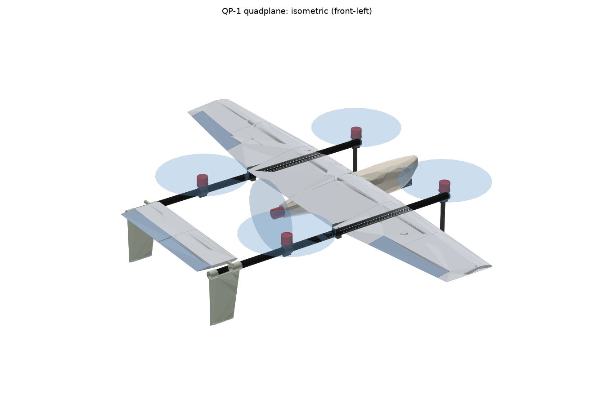

# QP-1: DIY 3D-printed VTOL quadplane

Parametric CAD and engineering analysis for a 3D-printed twin-boom quadplane:

- 1.80 m span, 1.36 m long, about 10 lb (4.65 kg) with battery and electronics.
- Four lift motors and a pusher.
- ArduPilot QuadPlane.

Everything (CAD, XFOIL, AVL, AeroSandbox) runs in Docker, driven by one parameter file.



## Documents

| Document | What it covers |
|---|---|
| [docs/requirements.md](docs/requirements.md) | requirements, with IDs |
| [docs/AerodynamicsReport.md](docs/AerodynamicsReport.md) | airfoil, sizing, propulsion, stability, performance and structures analysis |
| [docs/cots-selection.md](docs/cots-selection.md) | bought-part (COTS) selections and the reasons for them |
| [docs/decisions.md](docs/decisions.md) | decision log |

## Quick start (needs only Docker Desktop)

```sh
make image          # build the toolchain container (once, or after dependency changes)
make analysis       # full analysis chain -> docs/figures, analysis/results/*.json
make analysis-fast  # same, without the ~5 min XFOIL airfoil sweep
docker compose run --rm cad python scripts/assemble.py   # assembly STEP + renders + CAD mass
make build          # STL + STEP for every printable part (build/)
make test           # part validity, bed fit, layout constraints
make viewer         # interactive 3D viewer at http://localhost:3939
```

**Print order:**
1. `build/fit_coupon.stl`: tune the clearances in `quadplane/printer.py`.
2. An LW-PLA density test print.
3. Verify the motors, battery and camera against `quadplane/hardware.py`.
4. Rerun the chain above, then print the airframe.

## Layout

| Path | Contents |
|---|---|
| `quadplane/params.py` | the design (single source of truth) |
| `quadplane/parts/` | printable parts (wing, fuselage, booms, tail, fit_coupon) |
| `quadplane/cots.py` | reference geometry for bought parts |
| `analysis/` | a1 airfoils … a6 structures, plus the XFOIL and AVL drivers |
| `scripts/` | `assemble.py` (assembly, renders), `build_all.py` (exports) |
