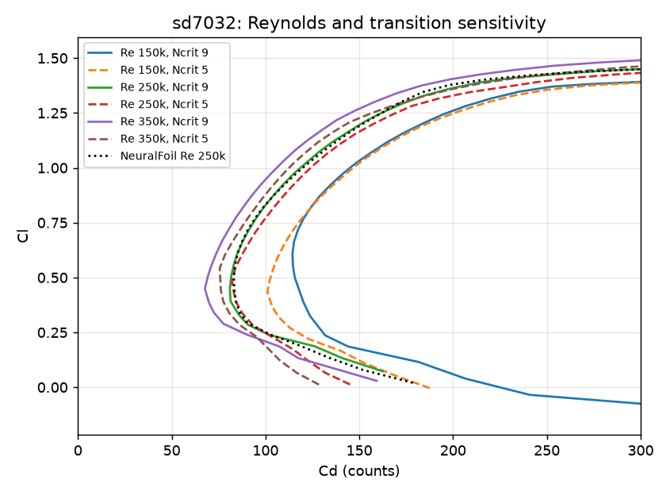
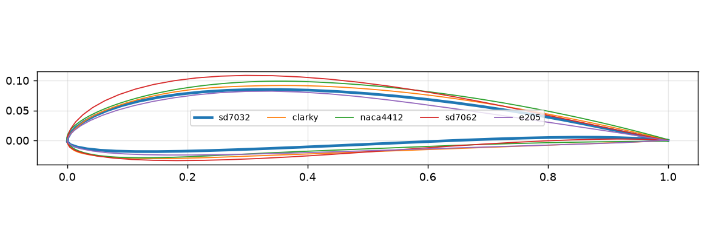
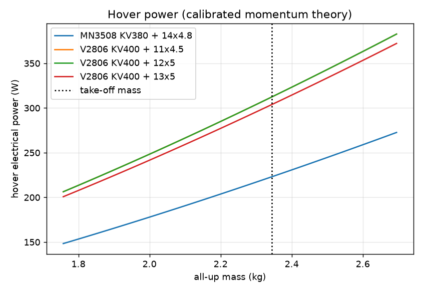
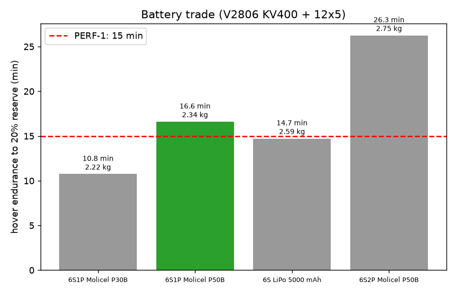
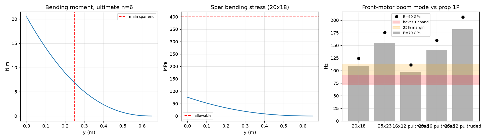

# QP-1 Quadplane: Aerodynamic Design and Analysis Report

| | |
|---|---|
| Document | QP-1-AR-001, revision D (draft for review): 5 lb class, sized around $29 lift motors |
| Date | 2026-11-18 (revision A: 2026-11-07; revision C, the 10 lb class: 2026-11-15) |
| Aircraft | QP-1, a 3D-printed VTOL quadplane, v1 proof of concept |
| Related | [requirements](requirements.md) · [decision log](decisions.md) · [COTS selection](cots-selection.md) |
| Reproduce | `make image && make analysis && make build && make test` (all inside Docker; see Appendix A) |

---

## Summary

QP-1 is a twin-boom quadplane with 1.30 m span and a take-off mass of about 5 lb
(2.34 kg, battery and electronics included). It hovers on four fixed lift motors and
cruises on a pusher motor. All the analysis in this report uses open-source tools:
XFOIL 6.99, AVL 3.40, AeroSandbox 4.2 (AeroBuildup) and NeuralFoil. Every number is
regenerated from one parameter file (`quadplane/params.py`) that also drives the CAD.
The printed-part masses fed back into the analysis come from that CAD.

**Revision D resizes the aircraft around lift motors that cost about $100 for four
(D-037).** The motor is the SunnySky V2806 KV400 at $28.99. Its full-throttle thrust with a
12 in prop is 1120 g, so four of them carry at most 2.39 kg with the required thrust margin.
Everything else follows from that limit: a 5 lb aircraft, a 6S1P battery, a 1.30 m wing and
a fifth motor of the same type as the pusher. Revisions B and C (the 10 lb class, 4.59 kg,
T-Motor MN4014 motors at $97 each) are in the git history and in decisions D-025 to D-036.
The airfoil trade (§3) was not re-run.


### Design point

| Quantity | Value | Requirement | Status |
|---|---|---|---|
| Take-off mass (CAD + COTS build-up) | **2.34 kg (5.17 lb)** | ≈ 5 lb (2.27 kg) target, D-037 | +3.3% over the target; 2.1% under the 2.39 kg thrust limit (§2) |
| Span / overall length / height | 1.30 / 1.065 / 0.34 m | ≤ 1.9 / ≤ 1.4 / ≤ 0.9 m | ✅ SIZE-1, SIZE-2 |
| Wing area, aspect ratio, MAC | 0.283 m², 5.98, 0.221 m | — | — |
| Airfoil | SD7032 (10% thick) | ≥ 10% t/c (printability) | ✅ |
| Stall speed (1 g, clean) | 10.3 m/s | ≤ 10.5 m/s (design rule) | ✅ |
| Maximum L/D (whole aircraft) | 12.3 at 14.75 m/s | — | — |
| **Hover power / hover endurance** | **312 W / 16.6 min** to a 20% reserve | ≥ 15 min (PERF-1) | ✅ **11% margin** (thin, R-18) |
| Thrust-to-weight, each lift motor | 1.84 | ≥ 1.8 (PERF-5) | ✅ (slim, R-1) |
| Cruise power at 18 m/s / at max range (15.25 m/s) | 77 W / 62 W | — | — |
| Cruise endurance at 15 m/s (model / planning) | 73 min / **~51 min** | none (PERF-4: measure) | — |
| Static margin at the CG | 10.0% MAC | 10–15% (QuadPlane practice) | ✅ |
| Short period / Dutch roll damping | ζ = 0.67 / 0.15 | Level 1: ≥ 0.35 / ≥ 0.08 | ✅ |
| Spiral mode | divergent, time to double 8.1 s | Level 2: ≥ 8 s | ⚠️ acceptable with autopilot (§6.6) |
| Spar ultimate margin (n = 6, 2.4 kg) | +428% | > 0 | ✅ |
| Boom first bending mode vs hover 1P band | 155–176 Hz vs 71–91 Hz | clear | ✅ (71% separation) |

### Main conclusions

1. **The lift motors set the weight, and both hover margins are thin.** At 2.34 kg each
   motor has a thrust-to-weight ratio of 1.84 against the 1.8 rule, and the aircraft is
   50 g under the mass where that rule fails. Hover endurance is 16.6 min against 15.
   A bigger pack does not help: 6S2P gives 26 min but takes the aircraft to 2.75 kg and the
   thrust-to-weight to 1.57 (§5.3). **Weigh every part.**
2. **All four lift motors now carry the same load.** With equal prop gaps the front pair
   carried 57% of the weight, which these motors cannot spare. The front motors moved
   65 mm ahead of the leading edge so the rotor centre sits on the CG (§6.4).
3. **Twin-boom vibration, not strength, still sizes the booms.** A 20x18 boom has its first
   bending mode only 21% above the hover prop frequency band; the rule is 25%. The 25x23
   tube gives 71% (§9.2).
4. **The pusher is a multirotor motor doing an aeroplane's job.** A fifth V2806 KV400 with a
   12x8 prop meets the transition thrust on paper at about 230 W, close to its 250 W
   rating, and its top speed is about 20 m/s. Its thrust is estimated, not measured:
   bench-test it before the first transition (§5.4, R-2).
5. **Pitch behaviour is good; the spiral mode is still mildly divergent** (flat wing, fins
   below the CG). §6.6 lists the cheap fixes if flight test shows it is a nuisance.
6. **The aircraft now fits between the Suburban's wheel wells** (1.065 m long, 1.30 m
   span), so the unmeasured 1.4 m width that revision C depended on no longer matters.
7. **The carbon comes from a hobby supplier with no published material data.** The
   analysis assumes ordinary roll-wrapped properties (§9). Check the delivered tubes
   before building on them (R-16).

---

## 1. Introduction and method

### 1.1 Scope
This report sizes and checks the aerodynamics, propulsion, stability and primary
structure of QP-1 against [requirements.md](requirements.md). It records why each
configuration parameter has its value. It does not cover detailed flight-control tuning,
the electrical design, or the regulatory paperwork.

### 1.2 Tools

| Tool | Version | Use | Source |
|---|---|---|---|
| **XFOIL** (Drela) | 6.99, built from source with a polar-append patch (Appendix A) | 2D airfoil polars, free and forced transition (e^N) | web.mit.edu/drela |
| **AVL** (Drela & Youngren) | 3.40 | Vortex-lattice model: neutral point, trim, stability derivatives, eigenmodes | web.mit.edu/drela |
| **AeroSandbox** | 4.2.10 | Whole-aircraft drag build-up (AeroBuildup): wing/tail sections from NeuralFoil, fuselage/boom drag, body effect on the neutral point | github.com/peterdsharpe/AeroSandbox |
| **NeuralFoil** | (with ASB) | Fast airfoil surrogate trained on XFOIL data; cross-check of XFOIL | github.com/peterdsharpe/NeuralFoil |
| build123d / OpenCascade | 0.13 | CAD; printed-part volumes, areas, centroids → mass model | github.com/gumyr/build123d |

Each tool is used where it is strongest:
- **XFOIL** for 2D section behaviour.
- **AVL** for lifting-surface stability. It models how the wing deflects the airflow onto
  the tail (downwash), but has no bodies.
- **AeroBuildup** for drag and for the destabilising effect of the bodies (fuselage,
  booms), but it does not model wing-to-tail downwash.

Where two tools overlap, they are compared and the more conservative (or more physically
appropriate) result is used (§6.1).

### 1.3 Analysis chain

```
params.py ──► CAD (build123d) ──► printed-part mass and centroid ──┐
    │                                                               ▼
    ├─► a1 airfoils (XFOIL ×60 polars, NeuralFoil) ──► airfoil choice
    ├─► a2 sizing (AeroBuildup carpet: span × chord) ──► planform
    ├─► a4 stability (AVL + AeroBuildup) ──► NP, CG, battery position, modes
    ├─► a3 propulsion (calibrated momentum theory) ──► props, battery, pusher
    ├─► a5 performance (AeroBuildup polar) ──► speeds, power, endurance
    └─► a6 structures (beam theory, Rayleigh) ──► spar, booms
```

The loop was run until the design stopped changing. Revision D (the 5 lb resize) took six
passes: the first four moved the front motors, the boom spacing and the stab chord (§6.4,
§10), and the last two only confirmed the masses.

### 1.4 Atmosphere and conventions
- Sea-level ISA: ρ = 1.225 kg/m³, μ = 1.789×10⁻⁵ Pa·s.
- Body frame: +x forward, +y left, +z up. Origin at the wing-root leading edge (LE).
- MAC = mean aerodynamic chord. Static margin is given in % MAC.

---

## 2. Mass and balance

### 2.1 Mass build-up (final)

| Group | Mass (g) | Source |
|---|---|---|
| Battery, 6S1P Li-ion (Molicel P50B) | 450 | 6 cells at 70 g plus leads and wrap; the seller's shipping weight is 500 g; **VERIFY** |
| Printed structure (CAD) | 838 | CAD volume and area × print profile × material density |
| Printed allowances (TPU feet, glue, hinge tape) | 46 | estimate |
| Propulsion (5 × V2806, 4 lift props, 5 ESCs, pusher prop and adapter) | 384 | seller's listings; motor 47 g + 3 g cable |
| Carbon tubes (spar, tip spars, booms, tail spar) | 307 | tube geometry × 1550 kg/m³ |
| Avionics (FC, GPS, receiver, Remote ID, airspeed, 3 servos) | 125 | manufacturer |
| Wiring, connectors, hardware | 155 | estimate |
| Camera (Insta360 GO 3S) | 39 | manufacturer |
| **Total** | **2343 (5.17 lb)** | |

Printed parts by function (g): wing 281, ailerons 23, fuselage + collar + hatch 123,
camera cradle 19, boom saddles 103, motor mounts 142, fins 77, stabiliser + elevators 69.

### 2.2 Mass history

| Stage | Take-off mass | Cause |
|---|---|---|
| Requirements estimate | 2.75 kg | spreadsheet build-up |
| Revision A | 3.34 kg | first CAD, MN3508 motors, 6S2P pack |
| Revision B (10 lb class) | 4.65 kg | D-025 |
| Revision C (supplier-catalogue tubes) | 4.59 kg | D-033 |
| **Revision D (5 lb class)** | **2.34 kg** | D-037: $29 lift motors |

Where the 2.25 kg between revision C and revision D went:

| Change | Δ mass (g) | Why |
|---|---|---|
| Battery 6S3P → 6S1P | −840 | hover power fell from 506 W to 312 W; a larger pack is too heavy for the motors (§5.3) |
| Propulsion | −696 | five 50 g motors in place of four 171 g and one 222 g; 12 in props |
| Printed structure | −542 | wing area −48%, smaller tail and pod, 0.9 mm pod wall |
| Carbon tubes | −104 | 0.5 m spar, 10x8 tip tubes, 0.84 m booms |
| Wiring and hardware | −65 | shorter runs, lighter gauge for 45 A peak in place of 103 A |

The airframe is analysed at 2.34 kg. Structure is designed at **2.4 kg**
(`Mission.design_mass`), which is also the most the lift motors carry at the 1.8
thrust-to-weight rule (2.39 kg). The 5 lb target is `Mission.target_mass` (2.268 kg).

**Getting to exactly 5.0 lb** would take 75 g. The candidates are the front legs as carbon
rod with a TPU foot (−30 g), motor-mount and saddle infill (−20 g) and a lighter Remote ID
module (−15 g). Every gram removed also adds thrust margin.

### 2.3 Balance
- **Neutral point:** 0.117 m behind the root LE (§6.1).
- **CG target:** for a 10% MAC margin, the CG sits at **0.095 m (39.7% of root chord)**.
- **Battery:** the CG is set by sliding the battery. Its centre ends up **92 mm ahead of
  the LE**, 70 mm behind its forward limit (the pack front stays at least 50 mm behind the
  nose tip).
- **The lighter battery has less authority than before:** 10 mm of battery travel moves the
  CG 1.9 mm (it was 2.8 mm). Sliding it fully forward moves the CG 13 mm.
- **The lift motors no longer pull the CG aft.** Their centre is on the CG (§6.4), so a
  change in motor or prop mass does not move the balance point.

---

## 3. Airfoil selection

### 3.1 Operating conditions

| Condition | Speed | Chord | Reynolds number |
|---|---|---|---|
| Stall, root | 10.5 m/s | 0.240 m | 1.7×10⁵ |
| Stall, tip | 10.5 m/s | 0.158 m | 1.1×10⁵ |
| Max-range cruise, MAC | 15.25 m/s | 0.221 m | 2.3×10⁵ |
| Fast cruise, MAC | 18 m/s | 0.221 m | 2.7×10⁵ |

**Design lift band.** Cruise and loiter lift coefficients lie between 0.30 and 0.65 (at
18 m/s, C_L = 0.41). Polars were computed at Re = 150k, 250k and 350k.

**Revision D note.** The trade below was run for the revision A wing (chords 0.167–0.260 m)
and was **not re-run**. The revision D wing (chords 0.158–0.240 m) is almost the same size,
so its Reynolds numbers are the ones the trade was run at and the selection stands. The
sizing and performance sections use NeuralFoil at the actual Reynolds number, not these
polars.

**Surface roughness.** A 3D-printed, lightly sanded LW-PLA surface is not laminar-smooth,
so two transition criteria were run for every case:
- **N_crit = 9:** a smooth wing in calm air.
- **N_crit = 5:** early transition, representing print-layer roughness and turbulence.

### 3.2 Candidates and criteria
Ten low-Reynolds-number sections that are common on small UAVs were analysed:
Clark Y, SD7062, SD7037, SD7032, E205, E374, NACA 2412, NACA 4412, MH114 and NACA 23012.
That is 60 XFOIL polars, over α = −4° to 18°.

**Hard constraints:**
- **t/c ≥ 10%.** The section must hold the carbon spar (20 mm) with a printable wall, and keep
  a stiff trailing region.
- **|C_m0| ≤ 0.15.** A larger nose-down pitching moment costs trim drag and needs a bigger tail.

**Weighted score.** Each metric is normalised across the candidates:

| Metric | Weight | Why |
|---|---|---|
| Mean C_d over C_l 0.30–0.65, Re 250k, N_crit 9 | 20% | cruise drag, smooth |
| Same, N_crit 5 | 20% | cruise drag, rough printed surface |
| C_l,max at Re 150k | 20% | stall speed and transition margin at the tip Reynolds number |
| max C_l^1.5/C_d at Re 250k | 15% | endurance |
| \|C_m0\| | 15% | trim drag, tail size |
| Drop in C_l in the 3° after stall | 10% | gentle stall (a quadplane spends time near stall during transitions) |

### 3.3 Results (Re 250k unless noted)

| Airfoil | t/c | C_d band, N9 | C_d band, N5 | C_l,max (150k) | (C_l^1.5/C_d)max | (L/D)max | C_m0 | Stall drop | Score |
|---|---|---|---|---|---|---|---|---|---|
| **SD7032** | 0.100 | **0.0084** | **0.0086** | 1.40 | 87.1 | 84.6 | −0.094 | **0.02** | **0.690** |
| Clark Y | 0.117 | 0.0091 | 0.0092 | 1.38 | 81.9 | 79.6 | −0.094 | 0.07 | 0.562 |
| NACA 4412 | 0.120 | 0.0094 | 0.0099 | 1.45 | 94.5 | 85.3 | −0.107 | 0.18 | 0.510 |
| SD7062 | 0.140 | 0.0103 | 0.0106 | 1.59 | 84.2 | 76.9 | −0.082 | 0.05 | 0.490 |
| E205 | 0.105 | 0.0096 | 0.0093 | 1.18 | 84.9 | 82.5 | −0.066 | 0.15 | 0.459 |
| NACA 2412 | 0.120 | 0.0091 | 0.0094 | 1.30 | 68.4 | 72.1 | −0.053 | 0.28 | 0.439 |
| E374 | 0.109 | 0.0102 | 0.0095 | 1.11 | 77.5 | 81.5 | −0.060 | 0.20 | 0.354 |
| NACA 23012 | 0.120 | 0.0111 | 0.0114 | 1.28 | 63.2 | 57.4 | −0.006 | 0.09 | 0.275 |
| SD7037 ✗ | 0.092 | 0.0081 | 0.0082 | 1.30 | 78.0 | 80.6 | −0.082 | 0.19 | (0.624) excluded: t/c < 10% |
| MH114 ✗ | 0.131 | — | — | 1.75 | 117.8 | 99.7 | −0.191 | 0.02 | excluded: \|C_m0\| = 0.19 |


### 3.4 Selection: SD7032

SD7032 has the lowest drag across the whole design lift band, in both the smooth and the
rough condition. Its drag rises by only 2 counts when transition is forced early, so its
performance doesn't depend on keeping laminar flow over a printed surface. Its stall is
the gentlest of the group: C_l falls only 0.02 in the 3° after the peak.

Its C_l,max of 1.40 at Re 150k is adequate. A quadplane never needs a short-field landing,
because it lands vertically.

**Runner-up: Clark Y.** It is 0.7 drag counts worse and has a flat underside, which would
help a builder working on a bench. That matters nothing for a wing printed standing on its
end.

**Reynolds-number and roughness sensitivity** of SD7032:

| Re | C_l,max (N9 / N5) | (L/D)max (N9 / N5) | C_d band (N9 / N5) |
|---|---|---|---|
| 150k | 1.40 / 1.41 | 68.9 / 68.2 | 0.0118 / 0.0105 |
| 250k | 1.46 / 1.47 | 84.6 / 80.6 | 0.0084 / 0.0086 |
| 350k | 1.51 / 1.50 | 94.7 / 88.8 | 0.0072 / 0.0078 |

At 150k, early transition actually *reduces* drag in the band. It shortens the laminar
separation bubble (a short recirculation zone that forms at low Reynolds numbers), which
is the classic low-Re behaviour. The **NeuralFoil cross-check** (dotted line in the figure
below) agrees with XFOIL within a few drag counts in the cruise band, which confirms the
XFOIL runs converged on the right solution branch.



**Structural fit.** With a 10% thick section and a 240 mm root chord, the straight 20 mm
spar (positioned for the maximum minimum wall, §9.1) keeps **1.2 mm** of wall from the
centreline out to y = 0.25 m. Beyond that point the spar steps down to a 10 mm tube, which
also keeps 1.2 mm of wall out to the tip. This fit is what sets the minimum root chord
(§4.1).

**Tail.** NACA 0009 for both the horizontal and the vertical tail. It is symmetric, thin,
and easy to print.



---

## 4. Wing sizing

### 4.1 Constraints

| Constraint | Value | Origin |
|---|---|---|
| Take-off mass | ≤ 2.39 kg | four lift motors at 1120 g each, thrust-to-weight 1.8, 4% download (PERF-5, §5.2) |
| Stall speed | ≤ 10.5 m/s **at 2.39 kg** | transition margin (minimum airspeed ≈ 1.25 V_s ≈ 13 m/s); checked at the heaviest mass the motors allow, so the wing is not the first thing to fail if the build comes out heavy |
| Root chord | ≥ 240 mm | the 20 mm spar needs 0.9 mm of printed wall around it in a 10% section (`make test`) |
| Span | ≤ 1.40 m | a 500 mm centre spar plus two 500 mm catalogue tip tubes with 120 mm overlap (D-039); the doorway limit of 1.9 m is far away |
| Overall length | ≤ 1.40 m | SIZE-2; not active at this size |
| Tip chord | ≥ 150 mm | tip Reynolds number ≥ 10⁵ at stall; spar and print depth |

**The mass limit is the new constraint, and it changes what "best" means.** In revisions
A to C the wing was chosen for the lowest cruise power. Here every gram of wing comes out
of the thrust margin, so the trade picks the **smallest wing that meets the stall-speed
limit**, and uses cruise power only to choose between wings of the same area.

### 4.2 Trade study
The trade swept span (1.1–1.6 m) against root chord (220–290 mm) on a 6 × 8 grid. The
outer-panel taper was fixed at 0.66 over a 0.58 m constant-chord centre section between
the booms. At each grid point the script computed:
- mass, with wing and tip-tube mass scaling;
- the whole-aircraft drag polar (AeroBuildup, with 35 drag counts added for excrescences
  not modelled elsewhere: stopped lift props, motor bells, feet, pitot, camera, print steps);
- stall speed, using C_L,max,3D = 0.88 × the section C_l,max at the MAC Reynolds number
  (1.6×10⁵; taper and washout effect);
- power at 18 m/s and the minimum power.


Lines on the carpet plots:
- **White dashed:** V_s = 10.5 m/s at the analysed mass.
- **Red:** the 1.4 m length limit (off the plot at this size).
- **Orange:** the 150 mm tip-chord limit.
- **Magenta:** the 1.40 m span limit.
- **Star:** the selected design.

**Results.**
- 14 of the 48 grid points are feasible.
- The smallest feasible wings all have about 0.283 m² of area: 1.1 m × 280 mm,
  1.2 m × 260 mm and 1.3 m × 240 mm. They weigh within 9 g of each other.
- Of those, **1.30 m × 240 mm** has the highest aspect ratio and the lowest power at
  18 m/s (59 W at the sizing efficiency, against 62 W and 65 W).
- A 1.40 m × 240 mm wing would save 0.6 W more but adds 22 g and leaves only 27 g under
  the mass limit.
- At 2.39 kg the selected wing stalls at 10.43 m/s, so the stall and thrust limits are
  reached at about the same mass. A 250 mm chord (+11 g, V_s 10.1 m/s) is the fallback if
  flight test shows the stall margin is too thin.

### 4.3 Final planform

| Parameter | Value |
|---|---|
| Span | 1.300 m |
| Centre section | 0.580 m constant chord (between the booms; carries the booms and the fuselage) |
| Root chord / tip chord | 0.240 / 0.158 m (outer-panel taper 0.66) |
| Area, aspect ratio | 0.283 m², 5.98 |
| MAC | 0.221 m |
| Sweep | none at the quarter chord (straight spar line) |
| Incidence / tip washout | +1.0° / −2.0° (linear over the outer panels) |
| Dihedral | **0°** (§6.6) |
| Ailerons | 55–95% of the semi-span, 25% chord |
| Wing loading | 83 g/dm² (81.3 N/m²) |

**Washout.** The tips are twisted 2° nose-down relative to the root, so stall starts
inboard and the ailerons stay effective. With a 0.66 taper ratio and a 10% section, the
untwisted wing would stall near 60–70% of the semi-span (Schrenk, the classical
lift-distribution estimate), which is right in the aileron span.

**Incidence.** +1° gives an AVL trim α of 0.9° at 18 m/s, so the fuselage is about 1°
nose-up in fast cruise and about 3° at 15 m/s. If the camera view needs to be level, raise
the incidence to +2° (CAD parameter only).

---

## 5. Propulsion and energy

### 5.1 Hover model

For each rotor, actuator-disk momentum theory gives the ideal hover power:

  P_ideal = T^1.5 / √(2ρA)

where T is thrust, ρ is air density and A is the disk area. The real electrical power is

  P_elec = k · P_ideal,  with k = 1 / (FM · η_motor · η_ESC)

FM is the propeller's figure of merit (its hover efficiency); η are the motor and ESC
efficiencies. **k is calibrated against bench data at the hover point**, not assumed. For
the V2806 the bench data is the table on the seller's listing (22.2 V, SunnySky's EOLO CN
props).

| Motor and prop (6S) | Bench point | Combined FM·η |
|---|---|---|
| T-Motor MN3508 KV380 + 14x4.8 (revision A; $70 each) | 710 g at 64.4 W | 0.579 |
| SunnySky V2806 KV400 + 11x4.5 | 600 g at 71 W | 0.519 |
| **SunnySky V2806 KV400 + 12x5** | 600 g at 71 W | **0.476** |
| SunnySky V2806 KV400 + 13x5 | 600 g at 69 W | 0.452 |

Corrections applied explicitly:
- **Download (+4%):** thrust lost to the booms and motor pods sitting under the disk.
- **Voltage sag (+4%):** the mean pack voltage over a discharge sits below the 22.2 V of the
  bench test.
- **Avionics:** 10 W.

The hover thrust (609 g per motor) is 1.5% from the 600 g bench row, so the calibration is
used almost exactly where it was measured. **Two things are not as measured:** the bench
prop is a 12x5 and the prop bought is a 12x4.5 (§5.2), and this is a seller's table, coarser
than T-Motor's. Confirm on the first hover log (battery current vs throttle).

### 5.2 Lift motor and prop selection

The motor is fixed by the budget (BUILD-1c, D-037): **SunnySky V2806 KV400**, 47 g,
$28.99, rated 250 W and 10 A for 180 s. What is left to choose is the prop.

| Motor + prop | Take-off mass | Hover power | Full-throttle thrust | T/W per motor | Overall length | Disk loading |
|---|---|---|---|---|---|---|
| V2806 + 11x4.5 | 2.33 kg | 310 W | 834 g | 1.38 ✗ | 1.014 m | 93 N/m² |
| **V2806 + 12x5** | **2.34 kg** | **312 W** | **1120 g** | **1.84** ✓ | **1.065 m** | 79 N/m² |
| V2806 + 13x5 | 2.35 kg | 304 W | 1080 g | 1.77 ✗ | 1.115 m | 67 N/m² |
| MN3508 + 14x4.8 (reference, $280 a set) | 2.58 kg | 256 W | 1730 g | 2.58 | 1.166 m | 64 N/m² |

T/W is full-throttle thrust against the weight each motor carries, with the 4% download
included.

- **Only the 12 in prop meets PERF-5.** The 11 in prop cannot load the motor: it reaches
  834 g. The 13 in prop overloads it: thrust falls to 1080 g and the seller's table shows
  the motor at 101 °C after 30 s at full throttle (77 °C after 3 min with the 12 in prop).
- **The margin is 2%.** Thrust-to-weight reaches 1.8 at 2.39 kg; the aircraft is 2.34 kg.
- **The prop bought is not the prop tested.** SunnySky's EOLO CN12x5 is not stocked in the
  US. The selected prop is a 12x4.5 carbon prop (14 g, CW/CCW pair) from the same shop.
  Half an inch less pitch should lower both the thrust and the motor load slightly.
  **Bench-test one motor and prop for full-throttle thrust before buying the rest** (R-1).
- The MN3508 row shows what the budget costs: the $70 motor would hover on 18% less power
  with 40% more thrust margin.

**Hover operating point** (the CG is midway between the motor pairs, §6.4):

| | Thrust per motor | Electrical power per motor | Fraction of max thrust | Speed |
|---|---|---|---|---|
| Front motors | 609 g | 72.6 W | 54% | 4860 rpm |
| Rear motors | 610 g | 72.7 W | 54% | 4870 rpm |

Total hover power is **312 W** (14.9 A from the pack). Each motor hovers at 29% of its
250 W rating.



### 5.3 Battery

| Option | Usable energy (80%) | Take-off mass | Hover time | Verdict |
|---|---|---|---|---|
| 6S1P Molicel P30B (3 Ah) | 52 Wh | 2.22 kg (4.9 lb) | 10.8 min | ✗ PERF-1; 45 A at full throttle is over its 36 A limit |
| **6S1P Molicel P50B (5 Ah)** | **86 Wh** | **2.34 kg (5.17 lb)** | **16.6 min** | ✅ **11% margin**; 45 A at full throttle (limit 60 A) |
| 6S LiPo 5000 mAh | 89 Wh | 2.59 kg (5.7 lb) | 14.8 min | ✗ PERF-1, and T/W falls to 1.66 |
| 6S2P Molicel P50B (10 Ah) | 173 Wh | 2.75 kg (6.1 lb) | 26.3 min | ✗ PERF-5: T/W falls to 1.57 |

"Full throttle" is all four lift motors at 190 W plus the pusher at 229 W: 989 W, 45 A.
That only happens briefly in a transition.

**Li-ion is the only chemistry that works here.** The LiPo pack of the same capacity is
250 g heavier, which costs both requirements at once.

**The 11% margin does not cover everything the 84% margin of revision C did:**
- capacity loss in the cold (about 10–20% at 5 °C for Li-ion);
- cell ageing (about 20% at 300 cycles);
- hover time spent in turbulence (tuning flights);
- further mass growth.

A new pack on a mild day should meet PERF-1. A cold or aged pack will not (R-18). The
requirement is for tuning sessions; plan them as 12–13 min hovers and carry two packs.



### 5.4 Pusher sizing

**Static thrust needed.** In a forward transition the aircraft accelerates to 14 m/s
(≈ 1.35 V_s) in 6 s with the lift motors still assisting. That requires 6.1 N. After
allowing for the pusher's thrust falling off with speed (linear lapse to the 25.6 m/s
in-flight pitch speed) and a **30% margin**, the static thrust required is **1.11 kg**
(10.9 N). The bare requirement, without the margin, is 0.85 kg.

**Cruise thrust.** 2.0 N at 18 m/s.

**Prop and motor.**
- A 12x8 prop (static C_T ≈ 0.105, C_P ≈ 0.060) needs 5,940 rpm and 187 W shaft
  (≈ 229 W electrical) to make 1.11 kg static.
- That calls for about **350 KV** on loaded 6S.
- **Selected: a fifth V2806 KV400 with an APC 12x8E** (D-037). It is the same motor as the
  lift positions, so one spare covers all five. At 400 KV the same estimate gives about
  1.4 kg static at about 330 W, which is over the motor's 250 W rating. **Limit the pusher
  throttle to about 90%** so it stays near 230 W.
- The motor's own bench table stops at 1260 g and 225 W (13x5 at 25 V), so the required
  thrust is inside what the motor has been shown to do, but not with this prop.
- The prop coefficients are database-order estimates. **Bench-test** the static thrust and
  current (open item C-1). An 11x7E unloads the motor; a 12x6E trades top speed for thrust.
- **Top speed.** The in-flight pitch speed at full throttle is about 25.6 m/s, so thrust
  runs out near 20 m/s (§7.2). This is a low-KV multirotor motor; it suits a 15 m/s cruise
  and not much more.
- The prop is fixed, not folding. The motor has no shaft for a folding spinner; it takes
  SunnySky's bolt-on prop adapter (**VERIFY** the fit on the V2806, C-9).
- Ground clearance under the 12 in disk is 37 mm.
- In plan view the pusher prop tip passes 20 mm from the rear lift-prop disks, and it is
  below their plane there. `make test` checks the plan clearance.

### 5.5 Cruise propulsive efficiency
Cruise uses η = **0.55** overall (prop 0.68 × motor 0.83 × ESC 0.97 at part load). This is
deliberately below the 0.62 used in the sizing trade (a relative comparison). The pusher
runs at about 40–55 W of shaft power in cruise, a part load for a 250 W motor.

---

## 6. Stability and control

### 6.1 Neutral point: AVL vs AeroBuildup

| Model | Neutral point, x behind root LE | Notes |
|---|---|---|
| **AVL**, lifting surfaces | **0.1216 m** (50.7% c_r) | includes wing downwash at the tail; no bodies |
| AeroBuildup, with bodies | 0.1907 m | no wing-to-tail downwash, so it over-predicts tail effectiveness |
| AeroBuildup, no bodies | 0.1950 m | — |
| Body increment (AeroBuildup) | −0.0043 m (forward) | fuselage pod, booms, motor pods (Munk effect: a body in the flow is destabilising) |
| **Design NP = AVL + body increment** | **0.1173 m** | |

**Why the two models disagree by 69 mm.** It's the downwash term. The tail's contribution
to stability scales with (1 − dε/dα), where dε/dα is how fast the downwash angle at the
tail grows with angle of attack. AeroBuildup effectively takes it as 0. The classical
estimate, dε/dα ≈ 2a/(πAR) = 2 × 4.91 / (π × 5.98) ≈ 0.52, removes about half of the tail's
effectiveness. So AVL, which computes the downwash directly, is used for the tail effect,
and only the body *increment* is taken from AeroBuildup, which models bodies and AVL
doesn't.

### 6.2 CG and static margin
- **Target 10% MAC (22 mm):** CG at **x = −0.095 m, 39.7% c_r**.
- Typical ArduPilot QuadPlane practice is 10–15%. The lower bound is kept. It gives
  C_mα = −0.59 /rad, solidly stable, with strong pitch damping (C_mq = −11.0).
- **CG range.** The battery sits 70 mm behind its forward limit at the 10% margin. Sliding
  it fully forward moves the CG 13 mm, to about 34.1% c_r (≈ 16% margin).
  - **Aft limit for flight: 39.7% c_r** (10% margin). Don't fly aft of it.
  - For very first flights, fly with the battery well forward (13–16% margin).
  - See R-9.

### 6.3 Tail sizing

| Parameter | Value | Typical (Raymer, homebuilt/sailplane) |
|---|---|---|
| Horizontal tail volume V_H | 0.569 | 0.40–0.50 |
| Vertical tail volume V_V | 0.053 | 0.02–0.04 |
| Tail arm (wing quarter-chord to stab quarter-chord) | 0.545 m | — |
| Stab: span × chord | 0.58 × 0.120 m, NACA 0009, 35% elevator | — |
| Fins: 2 × 0.20 m tall, chord 0.12 → 0.09 m | doubling as rear landing skids | — |

**Why both volumes are above the typical range.** The stab span is fixed by the boom
spacing (0.58 m), and the boom spacing is fixed by the pusher prop (§5.4). The stab chord
is then the smallest that still leaves a printable wall around its 8 mm spar. The fin
height is set by the ground clearance the pusher prop needs, not by V_V. A large tail is
not a problem here: it moves the neutral point aft, which is what lets the CG sit at 40%
chord, on the rotor centre (§6.4).

**Fins.** Each fin sleeves over the last 85 mm of the boom and the rest of its root
overhangs the boom end, as in revision C (D-034). The boom ends 34 mm behind the stab
leading edge and the fin leading edge is 51 mm ahead of it, below the boom.

**Stab incidence.** −0.3° gives an elevator deflection of **+1.8°** at the 18 m/s trim.
That is small, but it is not centred: at 15 m/s the trim moves further. Re-trim the stab
incidence after the first flights (CAD parameter only).

### 6.4 Hover balance
- The lift-motor centre is at x = −0.095 m and the CG at −0.095 m, so the front pair
  carries **50.0%** of the weight.
- **This is a design change, not a coincidence (D-038).** With the same 15 mm gap front and
  rear, the motors are symmetric about mid-chord (50% c_r) while the CG has to sit near
  40% for stability. The front pair then carried 57% of the weight and its
  thrust-to-weight was 1.63.
- The front props now sit **65 mm ahead of the leading edge** and the rear props 15 mm
  behind the trailing edge. That costs 50 mm of boom overhang (§9.2) and nothing else.
- Equal loading also gives the autopilot the same yaw authority in both directions, and
  the lowest hover power for a given weight.
- **Keep it balanced.** Anything that moves the CG moves the split: 10 mm of CG travel
  shifts 1.6% of the weight between the pairs. The battery position that gives the 10%
  static margin is also the one that balances the motors.

### 6.5 Trim and derivatives (AVL, 18 m/s, about the CG)

| Derivative | Value | Comment |
|---|---|---|
| α_trim, C_L | 0.88°, 0.409 | fuselage slightly nose-up |
| δ_e,trim | +1.83° | |
| C_Lα | 4.91 /rad | finite-wing lift slope, AR 6.0 |
| C_mα | −0.595 /rad | |
| C_mq | −11.0 /rad | pitch damping |
| C_nβ | +0.127 /rad | directionally stable |
| C_lβ | **+0.019 /rad** | slightly adverse dihedral effect (§6.6) |
| C_Yβ | −0.354 /rad | |
| C_lp | −0.440 /rad | roll damping |
| C_nr | −0.107 /rad | yaw damping |
| Span efficiency e (inviscid) | 1.00 | nearly elliptic loading |

### 6.6 Dynamic modes (AVL eigen-analysis, distributed mass model)

| Mode | Eigenvalue | ω_n (rad/s) | ζ | Period / time constant | MIL-F-8785C (Class I, Cat. B) |
|---|---|---|---|---|---|
| Short period | −6.49 ± 7.26i | 9.74 | **0.67** | 0.87 s | Level 1: ζ 0.30–2.0 ✅ |
| Phugoid | −0.001 ± 0.595i | 0.60 | ≈ 0 (AVL, no drag) | 10.6 s | with drag, ζ ≈ 1/(√2·L/D) ≈ 0.06 → Level 1 (≥ 0.04) ✅ |
| Roll subsidence | −8.59 | — | — | τ_R = 0.116 s | Level 1: ≤ 1.4 s ✅ |
| Dutch roll | −0.89 ± 6.07i | 6.13 | **0.15** | 1.04 s | Level 1: ζ ≥ 0.08, ζω ≥ 0.15 (0.89) ✅ |
| Spiral | +0.086 | — | — | **time to double 8.1 s** | Level 1 ≥ 20 s ✗; Level 2 ≥ 8 s ✅ |


**The spiral mode.** C_lβ is slightly positive (+0.019 /rad), where a stable dihedral
effect would be negative, and the directional stability is strong (C_nβ = +0.127). That
combination gives a slow spiral divergence. Three things keep the dihedral effect from
being stabilising:
- **Flat wing.** The straight spar line runs tip to tip, so the wing has no dihedral (D-015).
- **Fins below the CG.** The fins hang under the booms to serve as landing gear. Fin area
  below the CG produces the opposite of a dihedral effect, and the fins are large relative
  to this wing (V_V = 0.053).
- **What AVL leaves out.** It doesn't model the stabilising effect of a high wing sitting
  above a fuselage, where crossflow around the pod pushes C_lβ negative. Handbook (DATCOM)
  methods put this effect at the same order as the computed value, but it was **not
  computed here**. The real aircraft may well be close to spirally neutral; flight test
  will tell.

**Consequence.** An 8 s time to double is far slower than the attitude loop of any
ArduPilot mode except MANUAL. In MANUAL it is an easily flown slow divergence.

**Fixes, if flight test shows a problem** (in order of cost):
- A raised outer-panel tip (3–5° polyhedral beyond the main spar's end, in the 10 mm
  tip-spar zone): CAD change only.
- Small dorsal fins above the booms.

### 6.7 Control power
- **Elevator (35% chord, ±20°):** trim uses less than 2° at 18 m/s, so about 90% of
  travel is available for manoeuvre and for the transition pitch-down.
- **Ailerons (40% of the semi-span, 25% chord):** AVL gives C_lδa = −0.0044 per degree.
  With C_lp = −0.440, the steady roll-rate parameter is pb/2V = 0.0044 × 15 / 0.440 ≈ **0.15**
  at 15° of aileron, where p is roll rate and b is span. That is about 2× the ≥ 0.07 typical
  for Class I aircraft. Expect about 4.1 rad/s (≈ 235°/s) at 18 m/s; ArduPilot will limit
  the rate.
- **Elevator power:** AVL gives C_mδe = −0.028 per degree, so ±20° of elevator spans
  ΔC_m = ±0.56. Trimming the whole CG range (34.1–39.7% of root chord) needs less than ±2°.
- **Yaw:** there is no rudder, by design.
  - In hover, yaw comes from differential lift-motor torque.
  - In forward flight, ArduPilot coordinates turns with the ailerons; adverse yaw is
    moderate at AR 6.0 with a C_nβ of 0.127.
  - A rudder can be added to the fins later. The fin CAD reserves the chord for it.

---

## 7. Performance

### 7.1 Drag polar
- Whole-aircraft polar from AeroBuildup at the CG, plus 35 drag counts for excrescences.
- Parabolic fit over C_L 0.1–0.9: **C_D0 = 0.0290**, k = 0.0781, which implies an
  effective Oswald factor (a measure of how efficiently the wing makes lift) of **0.68**.
  That fit includes profile drag that grows with C_L. The AVL inviscid span efficiency is
  1.00.

Drag build-up (AeroBuildup run on each component separately, α = 0°, 15 m/s, counts
referenced to the wing area):

| Component | Counts | Note |
|---|---|---|
| Wing | 241 | about 125 of this is induced drag (C_L ≈ 0.47 at α = 0°); about 115 is profile drag |
| Horizontal tail + fins | 53 | |
| Fuselage pod | 34 | |
| Booms + motor pods | 42 | |
| Excrescence allowance | 35 | added outside AeroBuildup |
| **Profile-drag total** | **≈ 280** | the fitted C_D0 = 290 is higher because the parabola is fitted across the whole lift range |

Compared with revision C, the wing is half the area but the pod, booms and tail did not
shrink in proportion, so every body's contribution in counts went up. Maximum L/D falls
from 13.9 to 12.3.


### 7.2 Characteristic speeds and power (2.34 kg, sea level)

| Point | Airspeed | Battery power | Notes |
|---|---|---|---|
| Stall, V_s | 10.3 m/s | — | C_L,max,3D = 1.25 |
| Minimum power (best endurance) | 11.75 m/s | 55 W | 1.14 V_s: too close to stall to use in practice |
| Best L/D | 14.75 m/s | — | L/D = 12.3 |
| **Maximum range** | **15.25 m/s** | **62 W** | recommended cruise: 15 m/s |
| Fast cruise | 18 m/s | 77 W | |
| Maximum level speed (12x8 pusher) | ≈ 20 m/s | — | limited by pusher pitch speed (§5.4) |
| Best climb | 12.25 m/s | — | 2.0 m/s at the 1.11 kg static-thrust requirement |

Hover takes 4.1× the power of cruise at 18 m/s.

### 7.3 Endurance and range
Mission profile:
1. 60 s hover take-off.
2. Transition (40 s at about 60% hover power).
3. Cruise.
4. 60 s hover landing.
5. Land with 20% reserve.

The VTOL segments use 12 Wh of the 86 Wh usable.

| Cruise speed | Model | Planning value (×0.7) |
|---|---|---|
| 11.75 m/s (minimum power) | 81 min | ~57 min |
| **15 m/s** | **~73 min / 65 km** | **~51 min / 46 km** |
| 18 m/s | 58 min | ~41 min |

**Why the 0.7 planning factor.** It covers drag the models don't capture: surface waviness
of printed skins, leakage through the aileron gaps, wing–pod–boom interference, a
windmilling pusher, and stopped-prop misalignment. It also covers part-load motor
efficiency uncertainty. This is engineering judgement, typical of the difference between
first-flight results and AeroBuildup-class predictions for small UAVs. **PERF-4: measure
the real value.**

### 7.4 Initial ArduPilot settings (from this analysis, to be refined in flight test)

| Parameter | Value | Basis |
|---|---|---|
| AIRSPEED_MIN | 13 m/s | 1.25 V_s |
| AIRSPEED_CRUISE | 15 m/s | maximum-range speed |
| AIRSPEED_MAX | 19 m/s | 1 m/s under the level-speed limit |
| Q_ASSIST_SPEED | 11.5 m/s | below AIRSPEED_MIN, above V_s |
| Q_TRANSITION_MS | 6000 | §5.4 transition time |
| Q_M_THST_HOVER | ≈ 0.50 | 54% of max thrust on every lift motor, thrust-curve corrected |
| THR_MAX | 90 | keeps the pusher near its 250 W rating (§5.4); set after the bench test |
| Harmonic notch | throttle- or ESC-RPM-based, centred near 81 Hz (hover 1P) | §9.2 |

---

## 8. Loads

**Load factor.** Limit **n = 4** for gusts and pull-ups, ultimate **n = 6** (safety factor 1.5).
Structure is designed at 2.4 kg.

**Gust check** (Pratt formula, the standard gust-load estimate):

  Δn = ρ V a K_g U_e / (2 W/S)

where V is airspeed, a is the lift slope, U_e the gust velocity and K_g a gust-alleviation
factor. Here a = 4.91 /rad, W/S = 81.3 N/m², the mass ratio μ_g = 12.5 and K_g = 0.62.

| Airspeed | Gust U_e | Δn | Total n | vs limit 4 / ultimate 6 |
|---|---|---|---|---|
| 15 m/s | 5 m/s (moderate) | 1.7 | 2.7 | ✅ |
| 18 m/s | 5 m/s | 2.1 | 3.1 | ✅ |
| 20 m/s | 5 m/s | 2.3 | 3.3 | ✅ |
| 15 m/s | 7.5 m/s (strong) | 2.6 | 3.6 | ✅ |
| 18 m/s | 7.5 m/s | 3.1 | **4.1** | **exceeds limit** by 2%, inside ultimate |
| 20 m/s | 7.5 m/s | 3.4 | **4.4** | **exceeds limit** by 11%, inside ultimate |

**Gusts are the critical flight case.** Operating limit: in strong turbulence, fly at
**16 m/s or less** (n ≤ 3.7 for a 7.5 m/s gust; replaces the 18 m/s limit of D-032). This
limit should go into the flight-test card. The spar has a large margin at n = 6 (§9.1), so
an excursion to 4.4 is not a structural concern for the carbon; the limit protects the
printed joints, which were not analysed.

Load cases:
- **Hover:** each lift motor carries up to 1.12 kg of thrust into the boom.
- **Landing:** vertical touchdown at up to 1 m/s on four contact points (front legs,
  fin skids). The parts are designed to fail locally, in TPU and printed material, before
  the carbon. The front legs keep the 16 × 8 mm PA-CF section that was drawn for a 3.3 kg
  aircraft, so they are lightly loaded at 2.34 kg (R-11).

---

## 9. Primary structure

### 9.1 Wing spar

**Supplier limit (D-033, D-039).** The carbon comes from one supplier. The main spar is one
**uncut 20x18 × 500 mm** tube, ending 250 mm from the centreline, and each outer wing is
carried on an **uncut 10x8 × 500 mm** tube that runs from 130 mm to 630 mm (120 mm inside
the main spar).

- **Load distribution:** Schrenk spanwise lift (the average of the planform and an ellipse)
  at ultimate n = 6, 2.4 kg.
- **Root loads:** bending moment **20.5 N·m**, shear 71 N.

| Member | Section | Stress at ultimate | Allowable | Margin |
|---|---|---|---|---|
| Main spar, root | 20x18 CF tube, I = 2701 mm⁴ | 76 MPa | 400 MPa | **+4.28** |
| Tip spar at y = 0.25 m (M = 6.8 N·m) | 10x8 CF tube | 117 MPa | 400 MPa | +2.42 |

Main spar candidates, at the same root moment:

| Tube | Stress at ultimate | Margin | Mass (0.50 m) |
|---|---|---|---|
| **20x18 roll-wrapped** | **76 MPa** | **+4.28** | **46 g** |
| 25x23 roll-wrapped | 47 MPa | +7.50 | 58 g |
| 20x16 pultruded | 44 MPa | +8.06 | 88 g |

**The main spar is far stronger than it needs to be.** It is 20x18 because the supplier's
next roll-wrapped size down, 14x12, comes only in 500 mm and would then have no room for
the tip tube inside it with a sleeve. A lighter centre spar would save about 15 g.

Tip tube candidates from the supplier's 500 mm roll-wrapped tubes:

| Tube | Stress at the spar end | Margin | Tip deflection at limit load | Mass (pair) |
|---|---|---|---|---|
| 8x6 | 197 MPa | +1.03 | 24 mm | 34 g |
| **10x8** | **117 MPa** | **+2.42** | **15 mm** | **44 g** |
| 14x12 | 55 MPa | +6.31 | 9 mm | 63 g (does not fit: 0.3 mm of skin left at the tip) |

The 10x8 tube bridges two wing joints alone: the root-to-mid joint at 290 mm and the
mid-to-tip joint at 470 mm are both outboard of the main spar's end (R-17). The boom
saddle is bonded across the root-to-mid joint as well.

**Material assumptions.** E = 70 GPa (lower bound) to 90 GPa (nominal). The 400 MPa
allowable knocks down the ~700 MPa flexural strength of roll-wrapped tube to cover crushing
at the clamps and manufacturing variation. **The supplier publishes no modulus or strength
data**, and its tubes are sold on finish (3K twill, gloss). These are assumed values; see
R-16 for the acceptance checks.

**Spar position.**
- At the limit load, the main spar end deflects 2 mm and the wing tip 15 mm (tubes only,
  lower-bound E).
- The spar is straight, so its height in the tapering, washed-out wing is set to maximise
  the minimum wall around **both** tubes. The result is z = 7.5 mm, keeping 1.2 mm of wall
  around the 20 mm tube and 1.2 mm around the 10 mm tube out to y = 0.63 m (checked in
  `make test`; the limit is 0.9 mm). In revision C the height was chosen for the main spar
  alone; at this size that left 0.7 mm at the tip.
- The 10 mm tip tube needs a sleeve (10 mm bore, 18 mm outside, two rings or one 120 mm
  piece) to centre it in the main tube.

**Torsion.** The printed LW-PLA skin carries the wing's torsion as a closed cell.

### 9.2 Booms: vibration governs

**Layout.** Each boom is a 25x23 tube cut to 840 mm, from 13.5 mm ahead of the front motor
axis to 34 mm behind the stab leading edge; the fin root carries on from there (§6.3).

**Model.** The front motor (111 g including the prop and the mount with its landing leg,
from the CAD) sits on a 0.217 m overhang ahead of the wing clamp. That is modelled as a
cantilever with a tip mass (Rayleigh method).

**Excitation.** The hover 1P band runs from the motors' hover speed less 12% to plus 12%:
4,280–5,450 rpm, or **71–91 Hz**. The first mode must sit at least 25% above the top of
that band (113 Hz).

| Tube (from the supplier) | Mass/m | First mode, E = 70 / 90 GPa | Clear of 1P? |
|---|---|---|---|
| 20x18 roll-wrapped | 93 g | 110 / 125 Hz | **no: 21% above with the lower modulus** |
| **25x23 roll-wrapped** | **117 g** | **155 / 176 Hz** | **yes: 71–94% above** |
| 16x12 pultruded | 136 g | 98 / 111 Hz | no (8% above) |
| 20x16 pultruded | 175 g | 141 / 160 Hz | yes, +98 g for the pair |
| 25x22 pultruded | 172 g | 182 / 206 Hz | yes, +92 g for the pair |

**Why the booms did not shrink with the aircraft.** The motors are a third of the mass they
were, but the props turn faster (4,860 rpm in hover against 4,750) and the overhang is
longer (217 mm against 206 mm) because the front motors moved forward to balance the hover
(§6.4). A 20x18 boom would save 40 g and misses the rule by 4 points. It becomes usable if
the front landing legs move off the motor mounts (the mount with its leg is 47 g of the
111 g tip mass); that is a CAD change for a later revision.

**Why not pultruded.** Pultruded tube has all its fibres along the axis. It splits under
clamp loads and is weak in torsion, and the motor mounts and fins clamp onto the booms.

**Stress isn't the issue:** at 1.12 kg thrust the ultimate stress in a 25x23 boom is only
8 MPa.

**Decision.** 25x23 roll-wrapped booms cut to 0.840 m (D-039), plus verification after
assembly: a tap test, then an FFT of the first hover log, followed by setting up
ArduPilot's harmonic notch filter.



---

## 10. Configuration and CAD

**What the CAD contains.** The parametric CAD (`quadplane/parts/*.py`) produces **26 printable
parts**, all inside the 390 × 390 × 340 mm bed of the QIDI Max 4, plus reference geometry for
the COTS parts. `make test` checks that each part:
- is a valid single solid;
- fits the bed;
- rests on z = 0 in its print orientation.

It also checks the layout constraints (span, length, boom and fin alignment, spar and
tip-tube wall, pusher prop against the rear lift-prop disks), and that every carbon tube is
a size and length the supplier stocks.

**Bed fit.** Nothing is near the bed limits any more. The tallest parts are the wing root
segments (290 mm, limit 335 mm) and the pod halves (265 mm).

**CAD changes in revision D** beyond the parameter values:
- The wing segment joints follow the planform: the root segment ends at the boom
  (290 mm), and the outer panel is split in two equal 180 mm pieces.
- The lift props have separate front and rear gaps to the wing (`Lift.front_gap`,
  `Lift.tip_gap`).
- The spar axis height is chosen for the main spar and the tip tube together (§9.1).
- The aileron servo lies on its side: the wing is about 17 mm deep at the pocket.
- The pod wall is two perimeters (0.9 mm) in place of 1.2 mm.
- The motor and pusher mounts take the V2806 pattern (19 mm bolt circle assumed, **VERIFY**).

| Part group | Parts | Material | Mass (g) |
|---|---|---|---|
| Wing segments (root, mid, tip × 2), printed span-up | 6 | LW-PLA, 0.5 mm wall, 2% gyroid | 281 |
| Ailerons | 2 | LW-PLA | 23 |
| Fuselage nose, rear, collar, hatch | 4 | LW-PLA, 0.9 mm; PETG collar | 123 |
| Camera cradle | 1 | TPU | 19 |
| Boom saddles | 2 | PA-CF | 103 |
| Motor mounts, front (with landing legs) and rear | 4 | PA-CF | 142 |
| Fins (with boom sleeves and stab-spar sockets) | 2 | LW-PLA | 77 |
| Stabiliser halves, elevators | 4 | LW-PLA | 69 |
| Fit coupon (calibration) | 1 | PETG | — |

**The printed fittings are now a large share of the mass.** Saddles and motor mounts are
245 g, 10% of the aircraft, because they clamp 25 mm booms and were drawn for motors three
times heavier. They are the first place to look for weight (§2.2).


---

## 11. Risks and recommendations

| # | Risk or finding | Severity | Mitigation |
|---|---|---|---|
| R-1 | **Hover thrust margin is 2%** (T/W 1.84 vs 1.8; the rule fails at 2.39 kg, 50 g above the analysed mass). The thrust figure is a seller's bench table with a 12x5 prop; the prop bought is a 12x4.5 | **High** | Bench-test one motor and prop for full-throttle thrust and temperature before buying five. Weigh every part; mass-reduction candidates are in §2.2. If the thrust is short there is no larger prop to fall back on (§5.2); the fallback is the MN3508 class motor at $70 |
| R-2 | **Pusher thrust, current and temperature are estimated**, on a multirotor motor near its 250 W rating, with database-order prop coefficients | **High** | Bench test (C-1) before the first transition; limit pusher throttle to about 90%; 11x7E or 12x6E as adjustments. Top speed is about 20 m/s |
| R-3 | Spiral divergence (time to double 8.1 s) | Low | Autopilot modes; tip polyhedral if needed (§6.6) |
| R-4 | Boom 1P resonance margin (71% with E = 70 GPa) depends on a tube modulus the supplier doesn't publish | Low | Tap test before fitting the tail; harmonic notch |
| R-5 | Cruise-drag model uncertainty (±30%) | Low | 0.7 planning factor; not a requirement (PERF-4) |
| R-6 | LW-PLA density varies with print temperature (0.5–1.2 g/cm³). Printed parts are 36% of the mass, and 50 g of growth uses up the thrust margin | **High** | Print and weigh a calibration coupon before printing the airframe; update `printer.LWPLA` and rerun |
| R-7 | Suburban dimensions are estimated | Low | The aircraft (1.065 m × 1.30 m) fits the estimated 1.25 m between the wheel wells; test-fit when built |
| R-8 | NeuralFoil/AeroBuildup accuracy near stall at Re near 1.1×10⁵ (tip) | Low | Washout; ArduPilot minimum airspeed 1.25 V_s; Q_ASSIST |
| R-9 | Forward-CG range (battery 70 mm from its forward limit at 10% margin; 16% margin fully forward) | Low | First flights with the battery well forward |
| R-10 | Gust load factor exceeds the limit (n = 4.1) at 18 m/s in 7.5 m/s gusts | Low | Fly at 16 m/s or less in turbulence (n ≤ 3.7); the spar margin at ultimate is +4.3 |
| R-11 | Printed details were not strength-checked: front landing legs, motor-mount clamp rings, saddle bond area, wing bolts (2 × M4), the 0.9 mm pod wall | Medium | They were drawn for a 3.3 kg aircraft and are lightly loaded at 2.34 kg, except the pod wall, which is new: drop-test the pod with the battery in before flight |
| R-12 | Stall speed has little reserve (10.32 vs 10.5 m/s; the limit is reached at 2.43 kg) | Low | The thrust limit (2.39 kg) is reached first, so R-1 governs. The 250 mm root chord is the fallback (+11 g, V_s 10.1 m/s) |
| R-13 | The V2806 bolt pattern, its prop mount, the prop adapter fit and the 6S1P pack size and mass are not from datasheets | Medium | Verify on delivery (C-2) before printing the mounts and the pod |
| R-14 | Hover balance depends on the CG: 10 mm of CG travel moves 1.6% of the weight between the motor pairs | Low | Set the CG by the battery position (§2.3); check the motor outputs in the first hover log |
| R-15 | **The fin root is primary structure.** The stab spar sits in a printed boss on the fin sleeve, over the last 4 mm of the boom, so the stabiliser and the rear landing loads go through the printed sleeve | Medium | Print the fin root (sleeve and stub) solid, in PETG or PA-CF if LW-PLA proves soft; load-test one fin to 3× its static landing load before flight |
| R-16 | **Carbon tube properties are assumed.** The supplier sells hobby-grade tubes by finish and publishes no modulus, strength or tolerance data | Low | On delivery: weigh each tube (20x18 ≈ 93 g/m, 25x23 ≈ 117 g/m, 10x8 ≈ 44 g/m), and measure OD and wall. The margins are now large enough (§9) that a bend test is optional |
| R-17 | Both outer wing joints (290 mm and 470 mm out) are bridged by the 10x8 tube alone | Medium | Bond the tube over its full length in the mid and tip segments; +2.4 margin on the tube itself. Check the root-to-mid joint by hand load before flight |
| R-18 | **Hover endurance margin is 11%** (16.6 vs 15 min). A cold or aged pack will not make 15 min, and no larger pack can be carried | Medium | Plan tuning hovers of 12–13 min and carry two packs. If PERF-1 must hold in the cold, the answer is a larger lift motor, not a larger battery |
| R-19 | The pusher prop passes 20 mm (plan view) from the rear lift-prop disks | Low | `make test` checks it; the pusher tip is below the lift-prop plane there. Don't fit a larger pusher prop without widening the booms |

**Before printing:**
1. **Bench-test one V2806** with the lift prop and with the pusher prop (R-1, R-2).
2. Print the fit coupon and an LW-PLA density coupon; update `printer.py` (R-6).
3. Receive the motors, battery and camera; verify `hardware.py` (R-13).
4. Rerun `make analysis && make build && make test`.

**During the build:**
- Weigh every part and add the measured masses to `analysis/results/cad_mass.json`; the
  analysis then picks them up automatically. **The aircraft must come in under 2.39 kg.**
- Do a CG check on the bench: the balance point must be 82–95 mm behind the wing-root LE
  (34.1–39.7% of root chord). **Never further aft.** The aft end of that range is also the
  point where the four lift motors share the weight equally.

---

## Appendix A: Reproducibility

```sh
make image        # Docker image: Python 3.12, build123d, AeroSandbox, NeuralFoil,
                  # AVL 3.40 and XFOIL 6.99 compiled from MIT sources
make analysis     # a1 airfoils (XFOIL, ~5 min) -> a2 sizing -> a4 stability -> a3 propulsion
                  #   -> a5 performance -> a6 structures; figures to docs/figures,
                  #   numbers to analysis/results/*.json
docker compose run --rm cad python scripts/assemble.py   # CAD assembly, renders, CAD mass
make build        # STL + STEP for every printable part (build/)
make test         # part validity, bed fit, layout constraints
```

**Toolchain notes:**
- **XFOIL 6.99 crash fix.** XFOIL 6.99 crashes on modern gfortran runtimes when it appends
  to the polar file (`iopol.f` / `xpol.f`: a write after the end-of-file marker). The
  Dockerfile patches `PLRADD` to open the file with `POSITION='APPEND'`.
- **Debian XFOIL.** Debian's `xfoil` package is built with floating-point traps that abort
  on exit, so it isn't used.
- **AVL graphics.** AVL runs with graphics disabled (`PLOP G`).

## Appendix B: Key assumptions

| Assumption | Value | Where used |
|---|---|---|
| Transition criterion | N_crit 9 (smooth) and 5 (rough) | §3 |
| 3D C_L,max factor | 0.88 × section C_l,max | §4, §7 |
| Excrescence drag | +0.0035 C_D | §4, §7 |
| Hover download / voltage sag | 4% / 4% | §5 |
| Cruise η (prop × motor × ESC) | 0.55 | §7 |
| CF tube E / allowable | 70–90 GPa / 400 MPa | §9 |
| Hover 1P band / mode separation | hover rpm ± 12% / ≥ 25% above | §9.2 |
| Pusher static C_T / C_P (12x8) | 0.105 / 0.060 | §5.4 |
| Pusher in-flight rpm at full throttle | 0.85 × no-load (400 KV × 22.2 V) | §5.4, §7.2 |
| Lift motor thrust and power | seller's bench table, 22.2 V, EOLO CN12x5 | §5 |
| LW-PLA foamed density | 0.75 g/cm³ | §2 |
| Print profiles (wall, infill) | `scripts/build_all.py` | §2, §10 |
