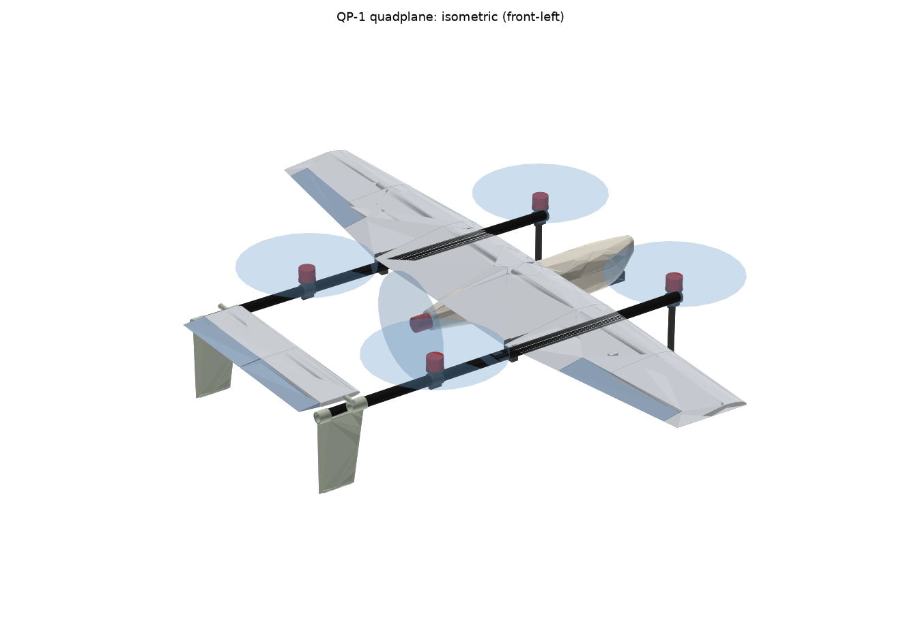
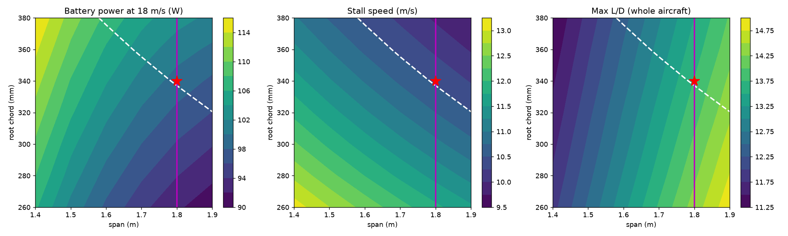
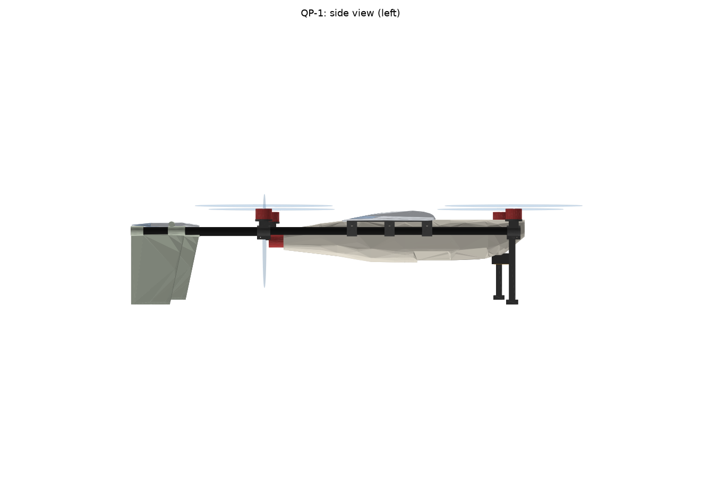

# QP-1 Quadplane: Aerodynamic Design and Analysis Report

| | |
|---|---|
| Document | QP-1-AR-001, revision B (draft for review): scaled to the 10 lb class |
| Date | 2026-11-15 (revision A: 2026-11-07) |
| Aircraft | QP-1, a 3D-printed VTOL quadplane, v1 proof of concept |
| Related | [requirements](requirements.md) · [decision log](decisions.md) · [COTS selection](cots-selection.md) |
| Reproduce | `make image && make analysis && make build && make test` (all inside Docker; see Appendix A) |

---

## Summary

QP-1 is a twin-boom quadplane with 1.80 m span and a take-off mass of about 10 lb
(4.65 kg, battery and electronics included). It hovers on four fixed lift motors and
cruises on a pusher motor. All the analysis in this report uses open-source tools:
XFOIL 6.99, AVL 3.40, AeroSandbox 4.2 (AeroBuildup) and NeuralFoil. Every number is
regenerated from one parameter file (`quadplane/params.py`) that also drives the CAD.
The printed-part masses fed back into the analysis come from that CAD.

**Revision B scales the aircraft from 3.34 kg to the 10 lb class (D-025).** The span stays
at 1.80 m (doorway). The chord, lift propulsion, battery, spar, booms, tail and pod all
grow, and the overall length grows from 1.196 m to 1.357 m, which needed a new length
limit (§4.1, D-026). The airfoil trade (§3) was not re-run; its conclusions carry over
because the Reynolds numbers only went up.



### Design point

| Quantity | Value | Requirement | Status |
|---|---|---|---|
| Take-off mass (CAD + COTS build-up) | **4.65 kg (10.25 lb)** | ≈ 10 lb (4.54 kg) target, D-025 | +2.5% over the target (§2) |
| Span / overall length / height | 1.80 / 1.357 / 0.35 m | ≤ 1.9 / ≤ 1.4 / ≤ 0.9 m | ✅ SIZE-1; SIZE-2 against the **new, unmeasured** 1.4 m limit |
| Wing area, aspect ratio, MAC | 0.539 m², 6.01, 0.305 m | — | — |
| Airfoil | SD7032 (10% thick) | ≥ 10% t/c (printability) | ✅ |
| Stall speed (1 g, clean) | 10.5 m/s | ≤ 10.5 m/s (design rule) | ✅ (at the limit) |
| Maximum L/D (whole aircraft) | 13.8 at 16 m/s | — | — |
| **Hover power / hover endurance** | **515 W / 27.2 min** to a 20% reserve | ≥ 15 min (PERF-1) | ✅ **81% margin** |
| Thrust-to-weight, most-loaded motor | 1.87 | ≥ 1.8 (PERF-5) | ✅ (slim) |
| Cruise power at 18 m/s / at max range (16.25 m/s) | 122 W / 108 W | — | — |
| Cruise endurance at 18 m/s (model / planning) | 105 min / **~73 min** | none (PERF-4: measure) | — |
| Static margin at the CG | 10.0% MAC | 10–15% (QuadPlane practice) | ✅ |
| Short period / Dutch roll damping | ζ = 0.67 / 0.15 | Level 1: ≥ 0.35 / ≥ 0.08 | ✅ |
| Spiral mode | divergent, time to double 8.3 s | Level 2: ≥ 8 s | ⚠️ acceptable with autopilot (§6.6) |
| Spar ultimate margin (n = 6, 4.8 kg) | +92% | > 0 | ✅ |
| Boom first bending mode vs hover 1P band | 130–147 Hz vs 60–89 Hz | clear | ✅ (≥ 46% separation) |

### Main conclusions

1. **The 15-minute hover requirement still drives the battery.** Hover takes 4.2× the
   power of cruise at 18 m/s. A 6S3P Li-ion pack (292 Wh) gives 27 min at the CAD mass and
   puts the aircraft at 10.25 lb. The 6S2P pack would still hover for 21 min at 9.3 lb,
   but it can't supply the full-throttle current (§5.3).
2. **10 lb does not fit in 1.2 m of length.** Front and rear lift props must clear the
   wing, so prop diameter and chord add directly to overall length. Both have to grow
   with mass (thrust margin and stall speed). The aircraft is 1.357 m long, and the
   Suburban length limit was re-estimated at 1.4 m. **Measure the vehicle before
   printing** (§4.1, R-7).
3. **Twin-boom vibration, not strength, sizes the booms.** The heavier motors on a 20 mm
   boom would sit inside the hover prop rotation frequency (1P) band. A 28x26 tube is
   selected (§9.2).
4. **The aircraft is statically and dynamically well behaved in pitch.** Its lateral
   behaviour is acceptable for an autopilot-flown aircraft but keeps the mildly divergent
   spiral mode of the smaller design (flat wing, fins below the CG). §11 lists the cheap
   fixes if flight test shows it's a nuisance.
5. **The aircraft came out 2.5% over the 10 lb target** (4.65 vs 4.54 kg), and the stall
   speed and the front-motor thrust margin are both at their limits. Weigh every printed
   part and keep updating the analysis. Structure is designed at 4.8 kg.

---

## 1. Introduction and method

### 1.1 Scope
This report sizes and checks the aerodynamics, propulsion, stability and primary
structure of QP-1 against [requirements.md](requirements.md). It records why each
configuration parameter has its value. It does not cover detailed flight-control tuning,
the electrical design, or the regulatory paperwork.

### 1.2 Tools

| Tool | Version | Use | Source |
|---|---|---|---|
| **XFOIL** (Drela) | 6.99, built from source with a polar-append patch (Appendix A) | 2D airfoil polars, free and forced transition (e^N) | web.mit.edu/drela |
| **AVL** (Drela & Youngren) | 3.40 | Vortex-lattice model: neutral point, trim, stability derivatives, eigenmodes | web.mit.edu/drela |
| **AeroSandbox** | 4.2.10 | Whole-aircraft drag build-up (AeroBuildup): wing/tail sections from NeuralFoil, fuselage/boom drag, body effect on the neutral point | github.com/peterdsharpe/AeroSandbox |
| **NeuralFoil** | (with ASB) | Fast airfoil surrogate trained on XFOIL data; cross-check of XFOIL | github.com/peterdsharpe/NeuralFoil |
| build123d / OpenCascade | 0.13 | CAD; printed-part volumes, areas, centroids → mass model | github.com/gumyr/build123d |

Each tool is used where it is strongest:
- **XFOIL** for 2D section behaviour.
- **AVL** for lifting-surface stability. It models how the wing deflects the airflow onto
  the tail (downwash), but has no bodies.
- **AeroBuildup** for drag and for the destabilising effect of the bodies (fuselage,
  booms), but it does not model wing-to-tail downwash.

Where two tools overlap, they are compared and the more conservative (or more physically
appropriate) result is used (§6.1).

### 1.3 Analysis chain

```
params.py ──► CAD (build123d) ──► printed-part mass and centroid ──┐
    │                                                               ▼
    ├─► a1 airfoils (XFOIL ×60 polars, NeuralFoil) ──► airfoil choice
    ├─► a2 sizing (AeroBuildup carpet: span × chord) ──► planform
    ├─► a4 stability (AVL + AeroBuildup) ──► NP, CG, battery position, modes
    ├─► a3 propulsion (calibrated momentum theory) ──► props, battery, pusher
    ├─► a5 performance (AeroBuildup polar) ──► speeds, power, endurance
    └─► a6 structures (beam theory, Rayleigh) ──► spar, booms
```

The loop was run until the design stopped changing. Revision A took three CAD-mass
iterations (§2.2). The revision B scale-up took four more, which changed the pod position,
the boom height and the stab incidence.

### 1.4 Atmosphere and conventions
- Sea-level ISA: ρ = 1.225 kg/m³, μ = 1.789×10⁻⁵ Pa·s.
- Body frame: +x forward, +y left, +z up. Origin at the wing-root leading edge (LE).
- MAC = mean aerodynamic chord. Static margin is given in % MAC.

---

## 2. Mass and balance

### 2.1 Mass build-up (final)

| Group | Mass (g) | Source |
|---|---|---|
| Battery, 6S3P Li-ion | 1290 | 18 cells at the built-pack mass of the 6S2P Flywoo P45B pack (71.7 g per cell); **VERIFY** |
| Printed structure (CAD) | 1379 | CAD volume and area × print profile × material density |
| Printed allowances (TPU feet, glue, hinge tape) | 56 | estimate |
| Propulsion (4 × MN4014, props, 5 ESCs, X3520, folding prop) | 1080 | manufacturer |
| Carbon tubes (spar, tip spars, booms, tail spar) | 460 | tube geometry × 1550 kg/m³ |
| Avionics (FC, GPS, receiver, Remote ID, airspeed, 3 servos) | 125 | manufacturer |
| Wiring, connectors, hardware | 220 | estimate |
| Camera (Insta360 GO 3S) | 39 | manufacturer |
| **Total** | **4649 (10.25 lb)** | |

Printed parts by function (g): wing 580, ailerons 44, fuselage + collar + hatch 239,
camera cradle 19, boom saddles 127, motor mounts 163, fins 95, stabiliser + elevators 112.

### 2.2 Mass growth history

| Stage | Take-off mass | Cause |
|---|---|---|
| Requirements estimate | 2.75 kg | spreadsheet build-up |
| Component model, pre-CAD | 2.97 kg | real COTS masses (MN3508 103 g, X2820 143 g, 20x18 booms) |
| First CAD pass | 3.44 kg | solid saddles, 1.6 mm PETG pod, PETG fins |
| Lightened CAD (revision A) | 3.34 kg | saddles opened up, LW-PLA pod and fins, saddle plate replaced by rails |
| **Scaled to the 10 lb class (revision B)** | **4.65 kg** | D-025: see the breakdown below |

Where the 1.31 kg between revision A and revision B went:

| Change | Δ mass (g) | Why |
|---|---|---|
| Battery 6S2P → 6S3P | +430 | hover time and pack current at the higher mass (§5.3) |
| Lift motors MN3508 → MN4014, 14 in → 15 in props | +296 | front-motor thrust-to-weight (§5.2) |
| Printed structure | +313 | wing area +31%, larger tail, wider pod, saddles and mounts for 28 mm booms |
| Carbon tubes | +140 | 28x26 booms 1.14 m long, 20x18 spar |
| Pusher motor and prop | +87 | 2.2 kg static thrust (§5.4) |
| Wiring and hardware | +40 | longer runs, heavier gauge |

The airframe is analysed at 4.65 kg. Structure and propulsion are designed at **4.8 kg**
(`Mission.design_mass`). The 10 lb target itself is `Mission.target_mass` (4.536 kg).

**Getting back to exactly 10.0 lb** would take about 115 g. The realistic candidates are
25x23 booms (−34 g, but only 23% above the 1P band instead of the 25% rule, §9.2), front
legs as carbon rod with a TPU foot (−40 g), and motor-mount infill (−20 g).

### 2.3 Balance
- **Neutral point:** 0.139 m behind the root LE (§6.1).
- **CG target:** for a 10% MAC margin, the CG sits at **0.109 m (32.0% of root chord)**.
- **Battery:** the CG is set by sliding the battery. Its centre ends up **151 mm ahead of
  the LE**, 29 mm behind its forward limit (the pack front stays at least 50 mm behind the
  nose tip).
- **Changes made to reach that CG at the new mass:**
  - The heavier lift motors sit symmetrically about a point 61 mm behind the CG, so they
    pull the CG aft. So do the longer, heavier booms and the larger tail.
  - The pod moved 50 mm forward relative to the wing (nose at +0.30 m, pusher mount face
    at −0.37 m), which moves the battery's forward limit with it.
  - The heavier battery has more authority: 10 mm of battery travel now moves the CG 2.8 mm.

---

## 3. Airfoil selection

### 3.1 Operating conditions

| Condition | Speed | Chord | Reynolds number |
|---|---|---|---|
| Stall, root | 10.5 m/s | 0.340 m | 2.4×10⁵ |
| Stall, tip | 10.5 m/s | 0.219 m | 1.6×10⁵ |
| Max-range cruise, MAC | 16.25 m/s | 0.305 m | 3.4×10⁵ |
| Fast cruise, MAC | 18 m/s | 0.305 m | 3.8×10⁵ |

**Design lift band.** Cruise and loiter lift coefficients lie between 0.30 and 0.65 (at
18 m/s, C_L = 0.43). Polars were computed at Re = 150k, 250k and 350k.

**Revision B note.** The trade below was run for the revision A wing (chords 0.167–0.260 m)
and was **not re-run** for the larger wing. Every Reynolds number went up by about 30%,
which favours all the candidates and doesn't change their ranking, so the selection stands.
The fast-cruise point is now slightly above the highest polar (350k); the sizing and
performance sections use NeuralFoil at the actual Reynolds number, not these polars.

**Surface roughness.** A 3D-printed, lightly sanded LW-PLA surface is not laminar-smooth,
so two transition criteria were run for every case:
- **N_crit = 9:** a smooth wing in calm air.
- **N_crit = 5:** early transition, representing print-layer roughness and turbulence.

### 3.2 Candidates and criteria
Ten low-Reynolds-number sections that are common on small UAVs were analysed:
Clark Y, SD7062, SD7037, SD7032, E205, E374, NACA 2412, NACA 4412, MH114 and NACA 23012.
That is 60 XFOIL polars, over α = −4° to 18°.

**Hard constraints:**
- **t/c ≥ 10%.** The section must hold the carbon spar (16 mm in revision A, now 20 mm) with a printable wall, and keep
  a stiff trailing region.
- **|C_m0| ≤ 0.15.** A larger nose-down pitching moment costs trim drag and needs a bigger tail.

**Weighted score.** Each metric is normalised across the candidates:

| Metric | Weight | Why |
|---|---|---|
| Mean C_d over C_l 0.30–0.65, Re 250k, N_crit 9 | 20% | cruise drag, smooth |
| Same, N_crit 5 | 20% | cruise drag, rough printed surface |
| C_l,max at Re 150k | 20% | stall speed and transition margin at the tip Reynolds number |
| max C_l^1.5/C_d at Re 250k | 15% | endurance |
| \|C_m0\| | 15% | trim drag, tail size |
| Drop in C_l in the 3° after stall | 10% | gentle stall (a quadplane spends time near stall during transitions) |

### 3.3 Results (Re 250k unless noted)

| Airfoil | t/c | C_d band, N9 | C_d band, N5 | C_l,max (150k) | (C_l^1.5/C_d)max | (L/D)max | C_m0 | Stall drop | Score |
|---|---|---|---|---|---|---|---|---|---|
| **SD7032** | 0.100 | **0.0084** | **0.0086** | 1.40 | 87.1 | 84.6 | −0.094 | **0.02** | **0.690** |
| Clark Y | 0.117 | 0.0091 | 0.0092 | 1.38 | 81.9 | 79.6 | −0.094 | 0.07 | 0.562 |
| NACA 4412 | 0.120 | 0.0094 | 0.0099 | 1.45 | 94.5 | 85.3 | −0.107 | 0.18 | 0.510 |
| SD7062 | 0.140 | 0.0103 | 0.0106 | 1.59 | 84.2 | 76.9 | −0.082 | 0.05 | 0.490 |
| E205 | 0.105 | 0.0096 | 0.0093 | 1.18 | 84.9 | 82.5 | −0.066 | 0.15 | 0.459 |
| NACA 2412 | 0.120 | 0.0091 | 0.0094 | 1.30 | 68.4 | 72.1 | −0.053 | 0.28 | 0.439 |
| E374 | 0.109 | 0.0102 | 0.0095 | 1.11 | 77.5 | 81.5 | −0.060 | 0.20 | 0.354 |
| NACA 23012 | 0.120 | 0.0111 | 0.0114 | 1.28 | 63.2 | 57.4 | −0.006 | 0.09 | 0.275 |
| SD7037 ✗ | 0.092 | 0.0081 | 0.0082 | 1.30 | 78.0 | 80.6 | −0.082 | 0.19 | (0.624) excluded: t/c < 10% |
| MH114 ✗ | 0.131 | — | — | 1.75 | 117.8 | 99.7 | −0.191 | 0.02 | excluded: \|C_m0\| = 0.19 |


### 3.4 Selection: SD7032

SD7032 has the lowest drag across the whole design lift band, in both the smooth and the
rough condition. Its drag rises by only 2 counts when transition is forced early, so its
performance doesn't depend on keeping laminar flow over a printed surface. Its stall is
the gentlest of the group: C_l falls only 0.02 in the 3° after the peak.

Its C_l,max of 1.40 at Re 150k is adequate. A quadplane never needs a short-field landing,
because it lands vertically.

**Runner-up: Clark Y.** It is 0.7 drag counts worse and has a flat underside, which would
help a builder working on a bench. That matters nothing for a wing printed standing on its
end.

**Reynolds-number and roughness sensitivity** of SD7032:

| Re | C_l,max (N9 / N5) | (L/D)max (N9 / N5) | C_d band (N9 / N5) |
|---|---|---|---|
| 150k | 1.40 / 1.41 | 68.9 / 68.2 | 0.0118 / 0.0105 |
| 250k | 1.46 / 1.47 | 84.6 / 80.6 | 0.0084 / 0.0086 |
| 350k | 1.51 / 1.50 | 94.7 / 88.8 | 0.0072 / 0.0078 |

At 150k, early transition actually *reduces* drag in the band. It shortens the laminar
separation bubble (a short recirculation zone that forms at low Reynolds numbers), which
is the classic low-Re behaviour. The **NeuralFoil cross-check** (dotted line in the figure
below) agrees with XFOIL within a few drag counts in the cruise band, which confirms the
XFOIL runs converged on the right solution branch.


**Structural fit.** With a 10% thick section, the straight 20 mm spar (positioned for the
maximum minimum wall, §9.1) keeps at least **3.3 mm** of wall from the centreline out to
y = 0.65 m. Beyond that point the spar steps down to an 8 mm tube.

**Tail.** NACA 0009 for both the horizontal and the vertical tail. It is symmetric, thin,
and easy to print.


---

## 4. Wing sizing

### 4.1 Constraints

| Constraint | Value | Origin |
|---|---|---|
| Span | ≤ 1.80 m | doorway (2.03 m) − 0.13 m handling margin − 0.10 m design margin (D-013) |
| Overall length | ≤ 1.40 m | Suburban cargo width **above** the wheel wells, ≈ 1.6 m estimated, less margin (SIZE-2 rev C, D-026). **Not measured.** |
| Stall speed | ≤ 10.5 m/s | transition margin (minimum airspeed ≈ 1.25 V_s ≈ 13 m/s) |
| Tip chord | ≥ 150 mm | tip Reynolds number ≥ 10⁵ at stall; spar and print depth |

**Why length constrains the chord.** The lift props must clear the wing. The front prop
tip sits 25 mm ahead of the LE and the rear prop tip 25 mm behind the TE, and the tail
sits behind the rear prop disk. So:

> length = 4R + c_root + 3 × gap + tail chord

where R is the prop radius. Every millimetre of root chord is a millimetre of length.

**Why the old 1.2 m limit had to go.** At 10 lb the front motors need 15 in props for the
thrust margin (§5.2), so 4R + 3 × gap alone is 0.837 m. A 1.2 m aircraft would be left with
0.36 m for the wing chord and the tail chord together. With a 0.18 m tail that is a 0.18 m
root chord and a stall speed near 14 m/s. The 1.2 m figure was the cargo floor width
*between* the wheel wells; SIZE-2a estimated about 1.6 m above them. Revision B uses that
space, so the aircraft has to rest on a cradle that lifts the nose or tail over a wheel
well (SIZE-4 already allows a cradle). See R-7.

### 4.2 Trade study
The trade swept span (1.4–1.9 m) against root chord (260–380 mm) on a 6 × 7 grid. The
outer-panel taper was fixed at 0.643 over a 0.60 m constant-chord centre section between
the booms. At each grid point the script computed:
- mass, with wing and spar mass scaling;
- the whole-aircraft drag polar (AeroBuildup, with 35 drag counts added for excrescences
  not modelled elsewhere: stopped lift props, motor bells, feet, pitot, camera, print steps);
- stall speed, using C_L,max,3D = 0.88 × the section C_l,max at the MAC Reynolds number
  (2.2×10⁵; taper and washout effect);
- power at 18 m/s and the minimum power.



Lines on the carpet plots:
- **White dashed:** V_s = 10.5 m/s.
- **Red:** the 1.4 m length limit.
- **Orange:** the 150 mm tip-chord limit.
- **Magenta:** the 1.80 m span limit.
- **Star:** the selected design.

**Results.**
- Six grid points are feasible. All have a root chord of 340 mm or more: the stall-speed
  limit sets a minimum area of about 0.53 m².
- Within the feasible region, the selected point (b = 1.80 m, c_r = 0.34 m) has the lowest
  power at 18 m/s (99 W at the sizing efficiency) and the shortest length (1.357 m).
- The next-best feasible point (b = 1.80 m, c = 0.36 m) costs 2 W and 20 mm of length, and
  buys 0.25 m/s of stall margin. It is the fallback if the built aircraft is heavy.
- A 1.9 m wing with a 0.32 m chord would save about 3 W and 20 mm of length, but its stall
  speed is 10.51 m/s and it uses the whole doorway margin (D-013 stands).

### 4.3 Final planform

| Parameter | Value |
|---|---|
| Span | 1.800 m |
| Centre section | 0.600 m constant chord (between the booms; carries the booms and the fuselage) |
| Root chord / tip chord | 0.340 / 0.219 m (outer-panel taper 0.643) |
| Area, aspect ratio | 0.539 m², 6.01 |
| MAC | 0.305 m |
| Sweep | none at the quarter chord (straight spar line) |
| Incidence / tip washout | +1.0° / −2.0° (linear over the outer panels) |
| Dihedral | **0°** (§6.6) |
| Ailerons | 55–95% of the semi-span, 25% chord |
| Wing loading | 86 g/dm² (84.6 N/m²) |

**Washout.** The tips are twisted 2° nose-down relative to the root, so stall starts
inboard and the ailerons stay effective. With a 0.64 taper ratio and a 10% section, the
untwisted wing would stall near 60–70% of the semi-span (Schrenk, the classical
lift-distribution estimate), which is right in the aileron span.

**Incidence.** +1° gives an AVL trim α of 1.4° at 18 m/s, so the fuselage is about 1.4°
nose-up in fast cruise and about 3° at 16 m/s. The lower aspect ratio needs more angle of
attack than revision A did. If the camera view needs to be level, raise the incidence to
+2° (CAD parameter only).

---

## 5. Propulsion and energy

### 5.1 Hover model

For each rotor, actuator-disk momentum theory gives the ideal hover power:

  P_ideal = T^1.5 / √(2ρA)

where T is thrust, ρ is air density and A is the disk area. The real electrical power is

  P_elec = k · P_ideal,  with k = 1 / (FM · η_motor · η_ESC)

FM is the propeller's figure of merit (its hover efficiency); η are the motor and ESC
efficiencies. **k is calibrated against the manufacturer's bench data at the hover
point**, not assumed.

| Motor and prop (6S) | Bench point | Combined FM·η |
|---|---|---|
| MN3508 KV380 + 14x4.8 (revision A) | 710 g at 64.4 W | 0.579 |
| **MN4014 KV400 + 15x5** | 1250 g at 126.5 W | **0.642** |
| MN4014 KV400 + 16x5.4 | 1410 g at 142.1 W | 0.642 |
| MN4014 KV400 + 17x5.8 | 1530 g at 168.7 W | 0.575 |

Corrections applied explicitly:
- **Download (+4%):** thrust lost to the booms and motor pods sitting under the disk.
- **Voltage sag (+4%):** the mean pack voltage over a discharge sits below the 22.2 V of the
  bench test.
- **Avionics:** 10 W.

Holding FM constant between the bench point (1250 g) and the hover points (1017–1401 g) is
a standard approximation. Its error grows with distance from the calibration point. Here
the hover thrust is within −19% / +12% of the bench point, closer than revision A was.
Confirm on the first hover log (battery current vs throttle).

### 5.2 Lift motor and prop selection

| Motor + prop | Take-off mass | Hover power | Total T/W | Front-motor T/W | Overall length | Disk loading |
|---|---|---|---|---|---|---|
| MN3508 + 14 in (revision A) | 4.35 kg | 554 W | 1.59 ✗ | 1.32 ✗ | 1.306 m | 108 N/m² |
| **MN4014 + 15 in** | **4.65 kg** | **515 W** | **2.25** | **1.87** ✓ | **1.357 m** ✓ | 100 N/m² |
| MN4014 + 16 in | 4.67 kg | 487 W | 2.59 | 2.15 | 1.408 m ✗ | 88 N/m² |
| MN4014 + 17 in | 4.69 kg | 514 W | 2.87 | 2.38 | 1.459 m ✗ | 79 N/m² |

T/W here is measured at full throttle against weight, with download included for the
front-motor figure.

- The revision A motor can't lift 10 lb with margin: its front motors would hover at 76%
  of full thrust.
- The MN4014 with 15x5 props meets PERF-5 with the shortest aircraft.
- The 16 in prop would save 29 W and raise the front-motor T/W to 2.15, for 51 mm more
  length. It misses the 1.40 m limit by 8 mm. **It is the first upgrade to make if the
  measured vehicle has room** (D-027).
- The 17 in prop is past this motor's efficient range and saves nothing.

**Hover operating point** (CG at 57.9% of the way from the rear motor pair to the front pair):

| | Thrust per motor | Electrical power per motor | Fraction of max thrust | Speed |
|---|---|---|---|---|
| Front motors | 1401 g | 150 W | 53% | 4760 rpm |
| Rear motors | 1017 g | 93 W | 39% | 4060 rpm |

Total hover power is **515 W** (24.5 A from the pack).


### 5.3 Battery

| Option | Usable energy (80%) | Take-off mass | Hover time | Verdict |
|---|---|---|---|---|
| 6S2P Molicel P45B | 156 Wh | 4.22 kg (9.3 lb) | 20.9 min | meets PERF-1, but 103 A at full throttle is over the pack's 90 A continuous limit |
| 6S LiPo 10000 mAh | 178 Wh | 4.66 kg | 20.6 min | meets PERF-1; same mass as 6S3P for 24% less energy |
| **6S3P Molicel P45B** | **233 Wh** | **4.65 kg (10.25 lb)** | **27.2 min** | ✅ **81% margin**; 34 A per cell at full throttle (limit 45) |
| 6S3P Molicel P50B | 259 Wh | 4.68 kg | 29.9 min | ✅ (drop-in alternative) |
| 6S4P Molicel P45B | 311 Wh | 5.08 kg (11.2 lb) | 31.8 min | front-motor T/W falls to 1.71 with download ✗ |

"Full throttle" is all four lift motors at 415 W plus the pusher at 633 W, 103 A. That
only happens briefly in a transition, but the pack should be able to supply it.

**Why the margin matters.** It covers:
- capacity loss in the cold (about 10–20% at 5 °C for Li-ion);
- cell ageing (about 20% at 300 cycles);
- further mass growth;
- hover time spent in turbulence (tuning flights).

**The 6S2P pack is a valid light configuration.** If 9.3 lb is acceptable, the revision A
pack still gives 21 min of hover and better thrust margin (front-motor T/W 2.06). Fly it
with the pusher throttle limited so the pack stays under 90 A. The battery bay and the CG
range take either pack.


### 5.4 Pusher sizing

**Static thrust needed.** In a forward transition the aircraft accelerates to 14 m/s
(≈ 1.35 V_s) in 6 s with the lift motors still assisting. That requires 11.9 N. After
allowing for the pusher's thrust falling off with speed (linear lapse to a 25 m/s pitch
speed) and a **30% margin**, the static thrust required is **2.19 kg** (21.5 N). The bare
requirement, without the margin, is 1.68 kg.

**Cruise thrust.** 3.41 N at 18 m/s.

**Prop and motor.**
- A 12x8 prop (static C_T ≈ 0.105, C_P ≈ 0.060) needs 8,340 rpm and 519 W shaft
  (≈ 630 W electrical) to make 2.19 kg static. Its pitch speed there is 28 m/s.
- That calls for about **500 KV** on loaded 6S.
- The selected SunnySky X3520 520KV is rated well above this power. At 520 KV the same
  estimate gives about **2.4 kg static**.
- The prop coefficients are database-order estimates, not this prop's measured values.
  **Bench-test** the static thrust (open item C-1); a 12x6.5 or a 13x8 folding prop are the
  adjustments either way.
- Ground clearance under the 12 in disk is 47 mm.

### 5.5 Cruise propulsive efficiency
Cruise uses η = **0.55** overall (prop 0.68 × motor 0.83 × ESC 0.97 at part load). This is
deliberately below the 0.62 used in the sizing trade (a relative comparison), because a
motor sized for 630 W static runs at about 90 W of shaft power in cruise, well below its
best-efficiency point.

---

## 6. Stability and control

### 6.1 Neutral point: AVL vs AeroBuildup

| Model | Neutral point, x behind root LE | Notes |
|---|---|---|
| **AVL**, lifting surfaces | **0.1436 m** (42.2% c_r) | includes wing downwash at the tail; no bodies |
| AeroBuildup, with bodies | 0.2064 m | no wing-to-tail downwash, so it over-predicts tail effectiveness |
| AeroBuildup, no bodies | 0.2105 m | — |
| Body increment (AeroBuildup) | −0.0042 m (forward) | fuselage pod, booms, motor pods (Munk effect: a body in the flow is destabilising) |
| **Design NP = AVL + body increment** | **0.1394 m** | |

**Why the two models disagree by 63 mm.** It's the downwash term. The tail's contribution
to stability scales with (1 − dε/dα), where dε/dα is how fast the downwash angle at the
tail grows with angle of attack. AeroBuildup effectively takes it as 0. The classical
estimate, dε/dα ≈ 2a/(πAR) = 2 × 4.73 / (π × 6.01) ≈ 0.50, removes about half of the tail's
effectiveness. The gap is larger than in revision A (33 mm) because the aspect ratio is
lower and the tail arm longer. So AVL, which computes the downwash directly, is used for
the tail effect, and only the body *increment* is taken from AeroBuildup, which models
bodies and AVL doesn't.

### 6.2 CG and static margin
- **Target 10% MAC (31 mm):** CG at **x = −0.109 m, 32.0% c_r**.
- Typical ArduPilot QuadPlane practice is 10–15%. The lower bound is kept from revision A.
  It gives C_mα = −0.55 /rad, solidly stable, with strong pitch damping (C_mq = −7.9).
- **The CG range is wider than in revision A.** The battery sits 29 mm behind its forward
  limit at the 10% margin. Sliding it fully forward moves the CG 8 mm, to about 29.7% c_r
  (≈ 12.6% margin).
  - **Aft limit for flight: 32.0% c_r** (10% margin). Don't fly aft of it.
  - For very first flights, fly with the battery fully forward (12.6% margin).
  - See R-9.

### 6.3 Tail sizing

| Parameter | Value | Typical (Raymer, homebuilt/sailplane) |
|---|---|---|
| Horizontal tail volume V_H | 0.464 | 0.40–0.50 |
| Vertical tail volume V_V | 0.039 | 0.02–0.04 |
| Tail arm (wing quarter-chord to stab quarter-chord) | 0.73 m | — |
| Stab: span × chord | 0.60 × 0.180 m, NACA 0009, 35% elevator | — |
| Fins: 2 × 0.22 m tall, chord 0.14 → 0.105 m | doubling as rear landing skids | — |

**Why V_H came down from 0.57.** The stab span is fixed by the boom spacing, so the only
way to keep V_H with a 31% larger wing is more tail chord, and tail chord adds directly to
overall length. A 0.18 m chord puts V_H in the middle of the typical range (D-030). The
static margin is set by the CG, not by V_H; what the smaller volume costs is pitch damping
(C_mq −7.9 vs −11.6) and CG tolerance. The short-period damping is still ζ = 0.67.

**Fins.** They grew to 0.22 m to keep V_V with the larger wing, and to give the 12 in
pusher prop 47 mm of ground clearance.

**Stab incidence.** −0.3° sets the elevator deflection at the 18 m/s trim to **−0.48°**,
essentially zero, so the elevator spends its full travel on control.

### 6.4 Hover balance
- The lift-motor centroid is at x = −0.170 m and the CG at −0.109 m, so the front pair
  carries **57.9%** of the weight.
- The resulting 38% thrust imbalance (1401 g vs 1017 g) is larger than revision A's 21%.
  It is within ArduPilot's mixing range, but it costs yaw authority in one direction; check
  the motor outputs in the first hover log.
- It leaves the front motors with T/W = 1.87, the governing hover margin.

**Why the CG can't simply sit at the motor centroid.** The motor centroid moves aft with
the chord (the rear props sit behind the trailing edge), while the CG has to stay near 32%
chord for stability. Moving the front motors further forward would even the split but adds
length. The current compromise is standard for twin-boom quadplanes.

### 6.5 Trim and derivatives (AVL, 18 m/s, about the CG)

| Derivative | Value | Comment |
|---|---|---|
| α_trim, C_L | 1.39°, 0.426 | fuselage slightly nose-up |
| δ_e,trim | −0.48° | |
| C_Lα | 4.73 /rad | finite-wing lift slope, AR 6.0 |
| C_mα | −0.548 /rad | |
| C_mq | −7.95 /rad | pitch damping |
| C_nβ | +0.090 /rad | directionally stable |
| C_lβ | **−0.0023 /rad** | essentially zero dihedral effect (§6.6) |
| C_Yβ | −0.229 /rad | |
| C_lp | −0.429 /rad | roll damping |
| C_nr | −0.082 /rad | yaw damping |
| Span efficiency e (inviscid) | 0.972 | nearly elliptic loading |

### 6.6 Dynamic modes (AVL eigen-analysis, distributed mass model)

| Mode | Eigenvalue | ω_n (rad/s) | ζ | Period / time constant | MIL-F-8785C (Class I, Cat. B) |
|---|---|---|---|---|---|
| Short period | −5.39 ± 5.96i | 8.04 | **0.67** | 1.05 s | Level 1: ζ 0.30–2.0 ✅ |
| Phugoid | 0.000 ± 0.596i | 0.60 | ≈ 0 (AVL, no drag) | 10.5 s | with drag, ζ ≈ 1/(√2·L/D) ≈ 0.05 → Level 1 (≥ 0.04) ✅ |
| Roll subsidence | −11.29 | — | — | τ_R = 0.089 s | Level 1: ≤ 1.4 s ✅ |
| Dutch roll | −0.73 ± 4.78i | 4.84 | **0.15** | 1.31 s | Level 1: ζ ≥ 0.08, ζω ≥ 0.15 (0.73) ✅ |
| Spiral | +0.083 | — | — | **time to double 8.3 s** | Level 1 ≥ 20 s ✗; Level 2 ≥ 8 s ✅ |


**The spiral mode.** C_lβ is essentially zero (−0.0023 /rad), while the directional
stability is strong (C_nβ = +0.090). That combination gives a slow spiral divergence.
Three things keep the dihedral effect near zero:
- **Flat wing.** The one-piece straight spar runs tip to tip, so the wing has no dihedral (D-015).
- **Fins below the CG.** The fins hang under the booms to serve as landing gear. Fin area
  below the CG produces the opposite of a dihedral effect.
- **What AVL leaves out.** It doesn't model the stabilising effect of a high wing sitting
  above a fuselage, where crossflow around the pod pushes C_lβ negative. Handbook (DATCOM)
  methods put this effect at the same order as the computed value, but it was **not
  computed here**. The real aircraft may well be close to spirally neutral; flight test
  will tell.

**Consequence.** An 8 s time to double is far slower than the attitude loop of any
ArduPilot mode except MANUAL. In MANUAL it is an easily flown slow divergence.

**Fixes, if flight test shows a problem** (in order of cost):
- A raised outer-panel tip (3–5° polyhedral beyond the main spar's end, in the 8 mm
  tip-spar zone): CAD change only.
- Small dorsal fins above the booms.

### 6.7 Control power
- **Elevator (35% chord, ±20°):** trim uses less than 1° at 18 m/s, so more than 95% of
  travel is available for manoeuvre and for the transition pitch-down.
- **Ailerons (40% of the semi-span, 25% chord):** AVL gives C_lδa = −0.0044 per degree.
  With C_lp = −0.429, the steady roll-rate parameter is pb/2V = 0.0044 × 15 / 0.429 ≈ **0.15**
  at 15° of aileron, where p is roll rate and b is span. That is about 2× the ≥ 0.07 typical
  for Class I aircraft. Expect about 3.1 rad/s (≈ 175°/s) at 18 m/s; ArduPilot will limit
  the rate.
- **Elevator power:** AVL gives C_mδe = −0.020 per degree, so ±20° of elevator spans
  ΔC_m = ±0.40. Trimming the whole CG range (29.7–32% of root chord) needs less than ±2°.
- **Yaw:** there is no rudder, by design.
  - In hover, yaw comes from differential lift-motor torque.
  - In forward flight, ArduPilot coordinates turns with the ailerons; adverse yaw is
    moderate at AR 6.0 with a C_nβ of 0.090.
  - A rudder can be added to the fins later. The fin CAD reserves the chord for it.

---

## 7. Performance

### 7.1 Drag polar
- Whole-aircraft polar from AeroBuildup at the CG, plus 35 drag counts for excrescences.
- Parabolic fit over C_L 0.1–0.9: **C_D0 = 0.0256**, k = 0.0839, which implies an
  effective Oswald factor (a measure of how efficiently the wing makes lift) of **0.63**.
  That fit includes profile drag that grows with C_L. The AVL inviscid span efficiency is
  0.97.

Drag build-up (AeroBuildup run on each component separately, α = 0°, 16 m/s, counts
referenced to the wing area):

| Component | Counts | Note |
|---|---|---|
| Wing | 215 | about 115 of this is induced drag (C_L ≈ 0.46 at α = 0°); about 100 is profile drag |
| Horizontal tail + fins | 33 | |
| Fuselage pod | 27 | |
| Booms + motor pods | 28 | |
| Excrescence allowance | 35 | added outside AeroBuildup |
| **Profile-drag total** | **≈ 225** | the fitted C_D0 = 256 is higher because the parabola is fitted across the whole lift range |

Compared with revision A, the lower aspect ratio (6.0 vs 7.9) raises induced drag, and the
larger wing area lowers every body's contribution in counts. Maximum L/D falls from 15.0
to 13.8.


### 7.2 Characteristic speeds and power (4.65 kg, sea level)

| Point | Airspeed | Battery power | Notes |
|---|---|---|---|
| Stall, V_s | 10.5 m/s | — | C_L,max,3D = 1.26 |
| Minimum power (best endurance) | 12.5 m/s | 95 W | 1.2 V_s: too close to stall to use in practice |
| Best L/D | 16.0 m/s | — | L/D = 13.8 |
| **Maximum range** | **16.25 m/s** | **108 W** | recommended cruise: 16 m/s |
| Fast cruise | 18 m/s | 122 W | |
| Maximum level speed (12x8 pusher) | ≈ 22 m/s | — | limited by pusher pitch speed |
| Best climb | 13.5 m/s | — | 2.3 m/s at the 2.19 kg static-thrust requirement |

### 7.3 Endurance and range
Mission profile:
1. 60 s hover take-off.
2. Transition (40 s at about 60% hover power).
3. Cruise.
4. 60 s hover landing.
5. Land with 20% reserve.

The VTOL segments use 21 Wh of the 233 Wh usable.

| Cruise speed | Model | Planning value (×0.7) |
|---|---|---|
| 12.5 m/s (minimum power) | 134 min | ~94 min |
| **16 m/s** | **~118 min / 115 km** | **~83 min / 81 km** |
| 18 m/s | 105 min | ~73 min |

**Why the 0.7 planning factor.** It covers drag the models don't capture: surface waviness
of printed skins, leakage through the aileron gaps, wing–pod–boom interference, a
windmilling pusher, and stopped-prop misalignment. It also covers part-load motor
efficiency uncertainty. This is engineering judgement, typical of the difference between
first-flight results and AeroBuildup-class predictions for small UAVs. **PERF-4: measure
the real value.**

### 7.4 Initial ArduPilot settings (from this analysis, to be refined in flight test)

| Parameter | Value | Basis |
|---|---|---|
| AIRSPEED_MIN | 13 m/s | 1.24 V_s |
| AIRSPEED_CRUISE | 16 m/s | maximum-range speed |
| AIRSPEED_MAX | 22 m/s | level-speed limit |
| Q_ASSIST_SPEED | 11.5 m/s | below AIRSPEED_MIN, above V_s |
| Q_TRANSITION_MS | 6000 | §5.4 transition time |
| Q_M_THST_HOVER | ≈ 0.50 | 53% of max thrust on the front pair, thrust-curve corrected |
| Harmonic notch | throttle- or ESC-RPM-based, centred near 74 Hz (hover 1P) | §9.2 |

---

## 8. Loads

**Load factor.** Limit **n = 4** for gusts and pull-ups, ultimate **n = 6** (safety factor 1.5).
Structure is designed at 4.8 kg.

**Gust check** (Pratt formula, the standard gust-load estimate):

  Δn = ρ V a K_g U_e / (2 W/S)

where V is airspeed, a is the lift slope, U_e the gust velocity and K_g a gust-alleviation
factor. Here a = 4.73 /rad, W/S = 84.6 N/m², the mass ratio μ_g = 9.8 and K_g = 0.57.

| Airspeed | Gust U_e | Δn | Total n | vs limit 4 / ultimate 6 |
|---|---|---|---|---|
| 18 m/s | 5 m/s (moderate) | 1.8 | 2.8 | ✅ |
| 22 m/s | 5 m/s | 2.1 | 3.1 | ✅ |
| 18 m/s | 7.5 m/s (strong) | 2.6 | 3.6 | ✅ |
| 22 m/s | 7.5 m/s | 3.2 | **4.2** | **exceeds limit** by 5%, inside ultimate |

**Gusts are still the critical structural case, but less so than in revision A** (n = 4.9
at 22 m/s): the wing loading is a little higher and the lift slope lower. Operating limit:
in strong turbulence, fly at **18 m/s or less** (n ≤ 3.6 for a 7.5 m/s gust; D-032). This
limit should go into the flight-test card.

Load cases:
- **Hover:** each lift motor carries up to 2.62 kg of thrust into the boom.
- **Landing:** vertical touchdown at up to 1 m/s on four contact points (front legs,
  fin skids). The parts are designed to fail locally, in TPU and printed material, before
  the carbon. The front legs kept their revision A section (16 × 8 mm PA-CF); check them
  against the 39% higher landing load before printing (R-11).

---

## 9. Primary structure

### 9.1 Wing spar
- **Load distribution:** Schrenk spanwise lift (the average of the planform and an ellipse)
  at ultimate n = 6, 4.8 kg.
- **Root loads:** bending moment **56.4 N·m**, shear 141 N.

| Member | Section | Stress at ultimate | Allowable | Margin |
|---|---|---|---|---|
| Main spar, root | 20x18 CF tube, I = 2701 mm⁴ | 209 MPa | 400 MPa | **+0.92** |
| Tip spar at y = 0.65 m (M = 3.1 N·m) | 8x6 CF tube | 90 MPa | 400 MPa | +3.5 |

Spar candidates at the same root moment:

| Tube | Stress at ultimate | Margin | Mass (1.30 m) |
|---|---|---|---|
| 16x14 (revision A) | 339 MPa | +0.18 | 95 g |
| 18x16 | 262 MPa | +0.53 | 108 g |
| **20x18** | **209 MPa** | **+0.92** | **120 g** |
| 22x20 | 170 MPa | +1.35 | 133 g |

The 16x14 tube would still be positive, but the deeper wing has room for a 20 mm tube, and
25 g buys back the margin revision A had (D-029).

**Material assumptions.** E = 70 GPa (lower bound) to 90 GPa (nominal). The 400 MPa
allowable knocks down the ~700 MPa flexural strength of roll-wrapped tube to cover crushing
at the clamps and manufacturing variation.

**Spar position.**
- At the limit load, the spar end deflects 24 mm (lower-bound E).
- The spar is straight, so its height in the tapering, washed-out wing is set to maximise
  the minimum wall. The result is z = 9.2 mm, keeping at least 3.3 mm of wall out to
  y = 0.65 m.
- The 8 mm tip tube runs 50 mm inside the main tube and needs a printed or turned sleeve
  (8 mm bore, 18 mm outside) to centre it.

**Torsion.** The printed LW-PLA skin carries the wing's torsion as a closed cell.

### 9.2 Booms: vibration governs

**Model.** The front motor (237 g including mount and prop) sits on a 0.216 m overhang
ahead of the wing clamp. That is modelled as a cantilever with a tip mass (Rayleigh method).

**Excitation.** The hover 1P band runs from the rear motors' hover speed less 12% to the
front motors' hover speed plus 12%: 3,570–5,340 rpm, or **60–89 Hz**. The first mode must
sit at least 25% above the top of that band (111 Hz).

| Tube | Mass/m | First mode, E = 70 / 90 GPa | Clear of 1P? |
|---|---|---|---|
| 20x18 (revision A) | 93 g | 77 / 87 Hz | **no: inside the band** |
| 22x20 | 102 g | 89 / 101 Hz | no |
| 25x23 | 117 g | 109 / 124 Hz | marginal: 23% above |
| **28x26** | **131 g** | **130 / 147 Hz** | **yes: 46–66% above** |
| 30x28 | 141 g | 144 / 164 Hz | yes, +11 g per boom |
| 25x22 | 172 g | 129 / 146 Hz | yes, +46 g per boom |

**Stress isn't the issue:** at 2.62 kg thrust the ultimate stress in a 28x26 boom is only
15 MPa.

**Decision.** 28x26 booms, 1.14 m long (D-029), plus verification after assembly: a tap
test, then an FFT of the first hover log, followed by setting up ArduPilot's harmonic notch
filter.


---

## 10. Configuration and CAD

**What the CAD contains.** The parametric CAD (`quadplane/parts/*.py`) produces **26 printable
parts**, all inside the 390 × 390 × 340 mm bed of the QIDI Max 4, plus reference geometry for
the COTS parts. `make test` checks that each part:
- is a valid single solid;
- fits the bed;
- rests on z = 0 in its print orientation.

It also checks the layout constraints (span, length, boom and fin alignment, spar wall).

**Bed fit after the scale-up.** The largest parts are close to the bed limits: the wing
root and mid segments are 340 mm in chord (limit 380 mm), the pod halves are 335 mm tall
(limit 340 mm) and the ailerons 358 mm long. A root chord above 380 mm, or a longer pod,
would need another split.

**CAD changes in revision B** beyond the parameter values: the two wing-bolt bosses at each
station are tied to the pod walls by a cross-web, the pod halves are split at mid-length,
the rear wing bolt moved to 40% chord (ahead of the pod's tail cone), and the boom saddle
lands wrap the full 28 mm tube.

| Part group | Parts | Material | Mass (g) |
|---|---|---|---|
| Wing segments (root, mid, tip × 2), printed span-up | 6 | LW-PLA, 0.5 mm wall, 2% gyroid | 580 |
| Ailerons | 2 | LW-PLA | 44 |
| Fuselage nose, rear, collar, hatch | 4 | LW-PLA, 1.2 mm | 239 |
| Camera cradle | 1 | TPU | 19 |
| Boom saddles | 2 | PA-CF | 127 |
| Motor mounts, front (with landing legs) and rear | 4 | PA-CF | 163 |
| Fins (with boom bands and stab-spar sockets) | 2 | LW-PLA | 95 |
| Stabiliser halves, elevators | 4 | LW-PLA | 112 |
| Fit coupon (calibration) | 1 | PETG | — |





---

## 11. Risks and recommendations

| # | Risk or finding | Severity | Mitigation |
|---|---|---|---|
| R-1 | **Hover thrust margin is slim** (front-motor T/W 1.87 vs 1.8), and depends on printed mass | High | Weigh every part; mass-reduction candidates are in §2.2. Fallbacks: 16x5.4 props (T/W 2.15, +51 mm length), or the 6S2P pack (T/W 2.06, 9.3 lb). |
| R-2 | Pusher static thrust is estimated from database-order prop coefficients, not measured | Medium | Bench test (C-1); 12x6.5 or 13x8 folding prop as adjustments |
| R-3 | Spiral divergence (time to double 8.3 s) | Low | Autopilot modes; tip polyhedral if needed (§6.6) |
| R-4 | Boom 1P resonance margin depends on tube modulus | Medium | Tap test; 30x28 tube fallback; harmonic notch |
| R-5 | Cruise-drag model uncertainty (±30%) | Low | 0.7 planning factor; not a requirement (PERF-4) |
| R-6 | LW-PLA density varies with print temperature (0.5–1.2 g/cm³) | Medium | Print and weigh a calibration coupon; update `printer.LWPLA` |
| R-7 | **Suburban dimensions are estimated, and the aircraft no longer fits between the wheel wells** (1.357 m long vs ≈ 1.25 m) | **High** | **Measure before printing** (SIZE-2a). It needs ≈ 1.4 m of width above the wheel wells and a cradle. If that isn't there, the options are a detachable tail, loading at an angle, or going back to the 3.3 kg revision A. |
| R-8 | NeuralFoil/AeroBuildup accuracy near stall at Re < 150k (tip) | Low | Washout; ArduPilot minimum airspeed 1.27 V_s; Q_ASSIST |
| R-9 | Forward-CG range (battery 29 mm from its forward limit at 10% margin; 12.6% margin fully forward) | Low | First flights with the battery fully forward; nose ballast beyond that |
| R-10 | Gust load factor slightly exceeds the limit (n = 4.2) at 22 m/s in 7.5 m/s gusts | Low | Fly at 18 m/s or less in turbulence (n ≤ 3.6); structure is inside ultimate (n = 6) |
| R-11 | Printed details were carried over from the 3.3 kg design without a strength check: front landing legs (16 × 8 mm PA-CF), motor-mount clamp rings, saddle bond area, wing bolts (2 × M4) | Medium | Hand-check each at 4.8 kg before printing; drop-test a front leg |
| R-12 | **Stall speed is at its limit** (10.46 vs 10.5 m/s) with no reserve for mass growth | Medium | Weigh parts; the 0.36 m root chord is the fallback (+20 mm length, V_s 10.2 m/s) |
| R-13 | Lift-motor and pusher bolt patterns, the X3520 mass and the 6S3P pack size and mass are not from datasheets | Medium | Verify on delivery (C-2) before printing the mounts and the pod |
| R-14 | Hover thrust split is 58/42 front/rear (38% imbalance) | Low | Check motor outputs and yaw authority in the first hover log |

**Before printing:**
0. **Measure the Suburban** (R-7). The whole revision depends on 1.4 m of usable width.
1. Print the fit coupon and an LW-PLA density coupon; update `printer.py`.
2. Receive the motors, battery and camera; verify `hardware.py`.
3. Rerun `make analysis && make build && make test`.

**During the build:**
- Weigh every part and add the measured masses to `analysis/results/cad_mass.json`; the
  analysis then picks them up automatically.
- Do a CG check on the bench: the balance point must be 101–109 mm behind the wing-root LE
  (29.7–32.0% of root chord). **Never further aft.**

---

## Appendix A: Reproducibility

```sh
make image        # Docker image: Python 3.12, build123d, AeroSandbox, NeuralFoil,
                  # AVL 3.40 and XFOIL 6.99 compiled from MIT sources
make analysis     # a1 airfoils (XFOIL, ~5 min) -> a2 sizing -> a4 stability -> a3 propulsion
                  #   -> a5 performance -> a6 structures; figures to docs/figures,
                  #   numbers to analysis/results/*.json
docker compose run --rm cad python scripts/assemble.py   # CAD assembly, renders, CAD mass
make build        # STL + STEP for every printable part (build/)
make test         # part validity, bed fit, layout constraints
```

**Toolchain notes:**
- **XFOIL 6.99 crash fix.** XFOIL 6.99 crashes on modern gfortran runtimes when it appends
  to the polar file (`iopol.f` / `xpol.f`: a write after the end-of-file marker). The
  Dockerfile patches `PLRADD` to open the file with `POSITION='APPEND'`.
- **Debian XFOIL.** Debian's `xfoil` package is built with floating-point traps that abort
  on exit, so it isn't used.
- **AVL graphics.** AVL runs with graphics disabled (`PLOP G`).

## Appendix B: Key assumptions

| Assumption | Value | Where used |
|---|---|---|
| Transition criterion | N_crit 9 (smooth) and 5 (rough) | §3 |
| 3D C_L,max factor | 0.88 × section C_l,max | §4, §7 |
| Excrescence drag | +0.0035 C_D | §4, §7 |
| Hover download / voltage sag | 4% / 4% | §5 |
| Cruise η (prop × motor × ESC) | 0.55 | §7 |
| CF tube E / allowable | 70–90 GPa / 400 MPa | §9 |
| Hover 1P band / mode separation | hover rpm ± 12% / ≥ 25% above | §9.2 |
| Pusher static C_T / C_P (12x8) | 0.105 / 0.060 | §5.4 |
| LW-PLA foamed density | 0.75 g/cm³ | §2 |
| Print profiles (wall, infill) | `scripts/build_all.py` | §2, §10 |
