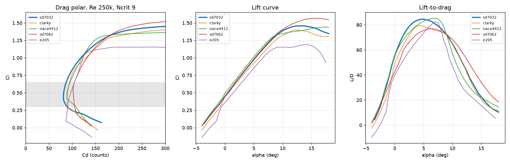
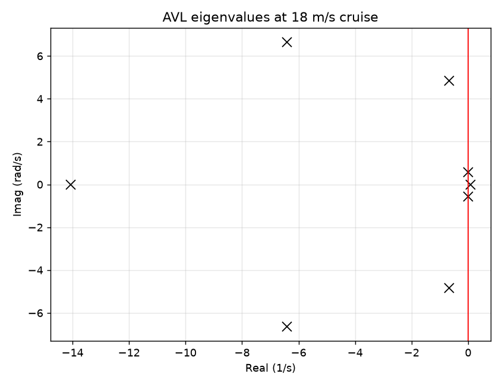
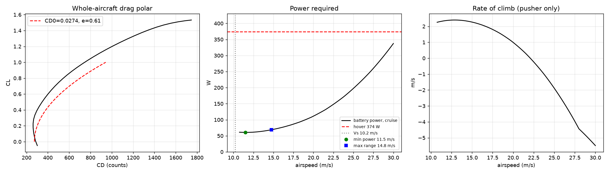
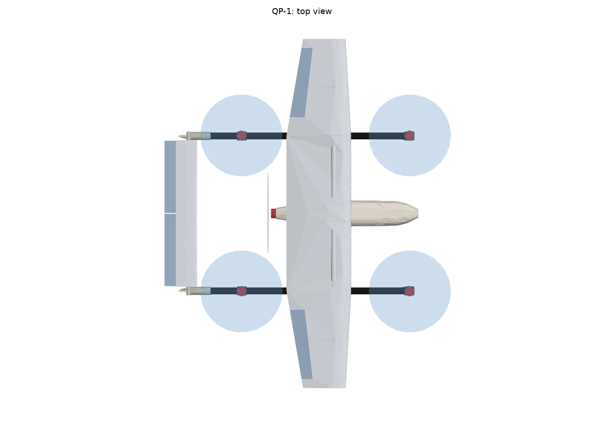
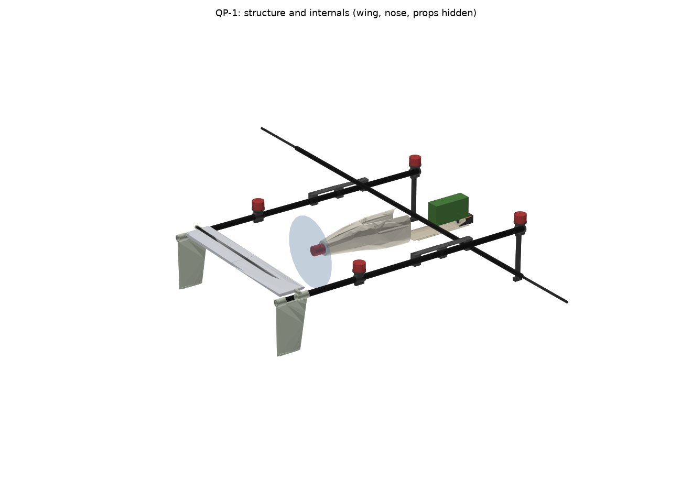

# QP-1 Quadplane: Aerodynamic Design and Analysis Report

| | |
|---|---|
| Document | QP-1-AR-001, revision A (draft for review) |
| Date | 2026-11-07 |
| Aircraft | QP-1, a 3D-printed VTOL quadplane, v1 proof of concept |
| Related | [requirements](requirements.md) · [decision log](decisions.md) · [COTS selection](cots-selection.md) |
| Reproduce | `make image && make analysis && make build && make test` (all inside Docker; see Appendix A) |

---

## Summary

QP-1 is a twin-boom quadplane with 1.80 m span. It hovers on four fixed lift motors and
cruises on a pusher motor. All the analysis in this report uses open-source tools:
XFOIL 6.99, AVL 3.40, AeroSandbox 4.2 (AeroBuildup) and NeuralFoil. Every number is
regenerated from one parameter file (`quadplane/params.py`) that also drives the CAD.
The printed-part masses fed back into the analysis come from that CAD.


### Design point

| Quantity | Value | Requirement | Status |
|---|---|---|---|
| Take-off mass (CAD + COTS build-up) | **3.34 kg** | none (2.75 kg was the initial estimate) | growth explained in §2 |
| Span / overall length / height | 1.80 / 1.196 / 0.29 m | ≤ 1.9 / ≤ 1.2 m | ✅ SIZE-1, SIZE-2 (Suburban estimated) |
| Wing area, aspect ratio, MAC | 0.412 m², 7.86, 0.233 m | — | — |
| Airfoil | SD7032 (10% thick) | ≥ 10% t/c (printability) | ✅ |
| Stall speed (1 g, clean) | 10.2 m/s | ≤ 10.5 m/s (design rule) | ✅ |
| Maximum L/D (whole aircraft) | 15.0 at 14 m/s | — | — |
| **Hover power / hover endurance** | **376 W / 24.9 min** to a 20% reserve | ≥ 15 min (PERF-1) | ✅ **66% margin** |
| Thrust-to-weight, most-loaded motor | 1.82 | ≥ 1.8 (PERF-5) | ✅ (slim) |
| Cruise power at 18 m/s / at max range (14.75 m/s) | 91 W / 69 W | — | — |
| Cruise endurance at 18 m/s (model / planning) | 93 min / **~65 min** | none (PERF-4: measure) | — |
| Static margin at the CG | 10.0% MAC | 10–15% (QuadPlane practice) | ✅ |
| Short period / Dutch roll damping | ζ = 0.69 / 0.14 | Level 1: ≥ 0.35 / ≥ 0.08 | ✅ |
| Spiral mode | divergent, time to double 8.4 s | Level 2: ≥ 8 s | ⚠️ acceptable with autopilot (§6.6) |
| Spar ultimate margin (n = 6, 3.4 kg) | +67% | > 0 | ✅ |
| Boom first bending mode vs hover 1P band | 106–121 Hz vs 63–87 Hz | clear | ✅ (≥ 22% separation) |

### Main conclusions

1. **The 15-minute hover requirement drives the design.** Hover takes 4.1× the power of
   cruise at 18 m/s. The 6S2P Li-ion pack (194 Wh) meets the requirement with a 66% margin
   at the CAD mass. A lighter pack doesn't hold enough margin (§5.3).
2. **The overall-length limit (Suburban) sets the root chord.** Front and rear lift props
   must clear the wing, so the chord adds directly to overall length. The wing is the
   smallest that keeps a stall speed of 10.5 m/s or less after the CAD mass growth (§4).
3. **Twin-boom vibration, not strength, sizes the booms.** A 16 mm boom would resonate
   with the hover prop rotation frequency (1P). A 20x18 tube is selected (§9.2).
4. **The aircraft is statically and dynamically well behaved in pitch.** Its lateral
   behaviour is acceptable for an autopilot-flown aircraft but has a mildly divergent spiral
   mode, because the fins hang below the CG and the wing is flat (one-piece spar). §11
   lists the cheap fixes if flight test shows it's a nuisance.
5. **Mass grew 22% from the first estimate** (2.75 → 3.34 kg), mostly in printed structure
   (§2). The design closes with that growth, but the hover thrust margin is now the
   tightest margin on the aircraft (1.82 vs 1.8). Weigh every printed part and keep
   updating the analysis.

---

## 1. Introduction and method

### 1.1 Scope
This report sizes and checks the aerodynamics, propulsion, stability and primary
structure of QP-1 against [requirements.md](requirements.md). It records why each
configuration parameter has its value. It does not cover detailed flight-control tuning,
the electrical design, or the regulatory paperwork.

### 1.2 Tools

| Tool | Version | Use | Source |
|---|---|---|---|
| **XFOIL** (Drela) | 6.99, built from source with a polar-append patch (Appendix A) | 2D airfoil polars, free and forced transition (e^N) | web.mit.edu/drela |
| **AVL** (Drela & Youngren) | 3.40 | Vortex-lattice model: neutral point, trim, stability derivatives, eigenmodes | web.mit.edu/drela |
| **AeroSandbox** | 4.2.10 | Whole-aircraft drag build-up (AeroBuildup): wing/tail sections from NeuralFoil, fuselage/boom drag, body effect on the neutral point | github.com/peterdsharpe/AeroSandbox |
| **NeuralFoil** | (with ASB) | Fast airfoil surrogate trained on XFOIL data; cross-check of XFOIL | github.com/peterdsharpe/NeuralFoil |
| build123d / OpenCascade | 0.13 | CAD; printed-part volumes, areas, centroids → mass model | github.com/gumyr/build123d |

Each tool is used where it is strongest:
- **XFOIL** for 2D section behaviour.
- **AVL** for lifting-surface stability. It models how the wing deflects the airflow onto
  the tail (downwash), but has no bodies.
- **AeroBuildup** for drag and for the destabilising effect of the bodies (fuselage,
  booms), but it does not model wing-to-tail downwash.

Where two tools overlap, they are compared and the more conservative (or more physically
appropriate) result is used (§6.1).

### 1.3 Analysis chain

```
params.py ──► CAD (build123d) ──► printed-part mass and centroid ──┐
    │                                                               ▼
    ├─► a1 airfoils (XFOIL ×60 polars, NeuralFoil) ──► airfoil choice
    ├─► a2 sizing (AeroBuildup carpet: span × chord) ──► planform
    ├─► a4 stability (AVL + AeroBuildup) ──► NP, CG, battery position, modes
    ├─► a3 propulsion (calibrated momentum theory) ──► props, battery, pusher
    ├─► a5 performance (AeroBuildup polar) ──► speeds, power, endurance
    └─► a6 structures (beam theory, Rayleigh) ──► spar, booms
```

The loop was run until the design stopped changing. That took three CAD-mass iterations
(§2.2), each of which changed the planform or the tail.

### 1.4 Atmosphere and conventions
- Sea-level ISA: ρ = 1.225 kg/m³, μ = 1.789×10⁻⁵ Pa·s.
- Body frame: +x forward, +y left, +z up. Origin at the wing-root leading edge (LE).
- MAC = mean aerodynamic chord. Static margin is given in % MAC.

---

## 2. Mass and balance

### 2.1 Mass build-up (final)

| Group | Mass (g) | Source |
|---|---|---|
| Battery, 6S2P Li-ion | 860 | manufacturer (Flywoo P45B pack, 860.7 g) |
| Printed structure (CAD) | 1066 | CAD volume and area × print profile × material density |
| Printed allowances (TPU feet, glue, hinge tape) | 56 | estimate |
| Propulsion (4 × MN3508, props, 5 ESCs, X2820, folding prop) | 697 | manufacturer |
| Carbon tubes (spar, tip spars, booms, tail spar) | 320 | tube geometry × 1550 kg/m³ |
| Avionics (FC, GPS, receiver, Remote ID, airspeed, 3 servos) | 125 | manufacturer |
| Wiring, connectors, hardware | 180 | estimate |
| Camera (Insta360 GO 3S) | 39 | manufacturer |
| **Total** | **3344** | |

Printed parts by function (g): wing 414, ailerons 33, fuselage + collar + hatch 212,
camera cradle 19, boom saddles 87, motor mounts 141, fins 69, stabiliser + elevators 92.

### 2.2 Mass growth history

| Stage | Take-off mass | Cause |
|---|---|---|
| Requirements estimate | 2.75 kg | spreadsheet build-up |
| Component model, pre-CAD | 2.97 kg | real COTS masses (MN3508 103 g, X2820 143 g, 20x18 booms) |
| First CAD pass | 3.44 kg | solid saddles, 1.6 mm PETG pod, PETG fins |
| Lightened CAD (final) | **3.34 kg** | saddles opened up, LW-PLA pod and fins, saddle plate replaced by rails |

The airframe is analysed at 3.34 kg. Structure and propulsion are designed at **3.4 kg**
(`Mission.design_mass`).

### 2.3 Balance
- **Neutral point:** 0.122 m behind the root LE (§6.1).
- **CG target:** for a 10% MAC margin, the CG sits at **0.099 m (37.9% of root chord)**.
- **Battery:** the CG is set by sliding the battery. Its centre ends up **126 mm ahead of
  the LE**, 4 mm behind its forward limit (the pack front stays at least 50 mm behind the
  nose tip).
- **Fixes made to reach that CG:**
  - The first CAD pass was tail-heavy.
  - The fins, the rear pod and the elevator hardware were lightened.
  - The GPS and Remote ID moved forward.
  - The nose was lengthened by 30 mm.
  - The static-margin target was set at the low end of practice, 10% (§6.2).

---

## 3. Airfoil selection

### 3.1 Operating conditions

| Condition | Speed | Chord | Reynolds number |
|---|---|---|---|
| Stall, root | 10.2 m/s | 0.260 m | 1.8×10⁵ |
| Stall, tip | 10.2 m/s | 0.167 m | 1.2×10⁵ |
| Max-range cruise, MAC | 14.75 m/s | 0.233 m | 2.4×10⁵ |
| Fast cruise, MAC | 18 m/s | 0.233 m | 2.9×10⁵ |

**Design lift band.** Cruise and loiter lift coefficients lie between 0.30 and 0.65 (at
18 m/s, C_L = 0.40). Polars were computed at Re = 150k, 250k and 350k.

**Surface roughness.** A 3D-printed, lightly sanded LW-PLA surface is not laminar-smooth,
so two transition criteria were run for every case:
- **N_crit = 9:** a smooth wing in calm air.
- **N_crit = 5:** early transition, representing print-layer roughness and turbulence.

### 3.2 Candidates and criteria
Ten low-Reynolds-number sections that are common on small UAVs were analysed:
Clark Y, SD7062, SD7037, SD7032, E205, E374, NACA 2412, NACA 4412, MH114 and NACA 23012.
That is 60 XFOIL polars, over α = −4° to 18°.

**Hard constraints:**
- **t/c ≥ 10%.** The section must hold a 16 mm carbon spar with a printable wall, and keep
  a stiff trailing region.
- **|C_m0| ≤ 0.15.** A larger nose-down pitching moment costs trim drag and needs a bigger tail.

**Weighted score.** Each metric is normalised across the candidates:

| Metric | Weight | Why |
|---|---|---|
| Mean C_d over C_l 0.30–0.65, Re 250k, N_crit 9 | 20% | cruise drag, smooth |
| Same, N_crit 5 | 20% | cruise drag, rough printed surface |
| C_l,max at Re 150k | 20% | stall speed and transition margin at the tip Reynolds number |
| max C_l^1.5/C_d at Re 250k | 15% | endurance |
| \|C_m0\| | 15% | trim drag, tail size |
| Drop in C_l in the 3° after stall | 10% | gentle stall (a quadplane spends time near stall during transitions) |

### 3.3 Results (Re 250k unless noted)

| Airfoil | t/c | C_d band, N9 | C_d band, N5 | C_l,max (150k) | (C_l^1.5/C_d)max | (L/D)max | C_m0 | Stall drop | Score |
|---|---|---|---|---|---|---|---|---|---|
| **SD7032** | 0.100 | **0.0084** | **0.0086** | 1.40 | 87.1 | 84.6 | −0.094 | **0.02** | **0.690** |
| Clark Y | 0.117 | 0.0091 | 0.0092 | 1.38 | 81.9 | 79.6 | −0.094 | 0.07 | 0.562 |
| NACA 4412 | 0.120 | 0.0094 | 0.0099 | 1.45 | 94.5 | 85.3 | −0.107 | 0.18 | 0.510 |
| SD7062 | 0.140 | 0.0103 | 0.0106 | 1.59 | 84.2 | 76.9 | −0.082 | 0.05 | 0.490 |
| E205 | 0.105 | 0.0096 | 0.0093 | 1.18 | 84.9 | 82.5 | −0.066 | 0.15 | 0.459 |
| NACA 2412 | 0.120 | 0.0091 | 0.0094 | 1.30 | 68.4 | 72.1 | −0.053 | 0.28 | 0.439 |
| E374 | 0.109 | 0.0102 | 0.0095 | 1.11 | 77.5 | 81.5 | −0.060 | 0.20 | 0.354 |
| NACA 23012 | 0.120 | 0.0111 | 0.0114 | 1.28 | 63.2 | 57.4 | −0.006 | 0.09 | 0.275 |
| SD7037 ✗ | 0.092 | 0.0081 | 0.0082 | 1.30 | 78.0 | 80.6 | −0.082 | 0.19 | (0.624) excluded: t/c < 10% |
| MH114 ✗ | 0.131 | — | — | 1.75 | 117.8 | 99.7 | −0.191 | 0.02 | excluded: \|C_m0\| = 0.19 |



### 3.4 Selection: SD7032

SD7032 has the lowest drag across the whole design lift band, in both the smooth and the
rough condition. Its drag rises by only 2 counts when transition is forced early, so its
performance doesn't depend on keeping laminar flow over a printed surface. Its stall is
the gentlest of the group: C_l falls only 0.02 in the 3° after the peak.

Its C_l,max of 1.40 at Re 150k is adequate. A quadplane never needs a short-field landing,
because it lands vertically.

**Runner-up: Clark Y.** It is 0.7 drag counts worse and has a flat underside, which would
help a builder working on a bench. That matters nothing for a wing printed standing on its
end.

**Reynolds-number and roughness sensitivity** of SD7032:

| Re | C_l,max (N9 / N5) | (L/D)max (N9 / N5) | C_d band (N9 / N5) |
|---|---|---|---|
| 150k | 1.40 / 1.41 | 68.9 / 68.2 | 0.0118 / 0.0105 |
| 250k | 1.46 / 1.47 | 84.6 / 80.6 | 0.0084 / 0.0086 |
| 350k | 1.51 / 1.50 | 94.7 / 88.8 | 0.0072 / 0.0078 |

At 150k, early transition actually *reduces* drag in the band. It shortens the laminar
separation bubble (a short recirculation zone that forms at low Reynolds numbers), which
is the classic low-Re behaviour. The **NeuralFoil cross-check** (dotted line in the figure
below) agrees with XFOIL within a few drag counts in the cruise band, which confirms the
XFOIL runs converged on the right solution branch.


**Structural fit.** With a 10% thick section, the straight 16 mm spar (positioned for the
maximum minimum wall, §9.1) keeps at least **2.1 mm** of wall from the centreline out to
y = 0.65 m. Beyond that point the spar steps down to an 8 mm tube.

**Tail.** NACA 0009 for both the horizontal and the vertical tail. It is symmetric, thin,
and easy to print.


---

## 4. Wing sizing

### 4.1 Constraints

| Constraint | Value | Origin |
|---|---|---|
| Span | ≤ 1.80 m | doorway (2.03 m) − 0.13 m handling margin − 0.10 m design margin (D-013) |
| Overall length | ≤ 1.20 m | Suburban cargo width between the wheel wells (estimated, SIZE-2) |
| Stall speed | ≤ 10.5 m/s | transition margin (minimum airspeed ≈ 1.25 V_s ≈ 13 m/s), with 0.5 m/s reserved for further mass growth |
| Tip chord | ≥ 150 mm | tip Reynolds number ≥ 10⁵ at stall; spar and print depth |

**Why length constrains the chord.** The lift props must clear the wing. The front prop
tip sits 25 mm ahead of the LE and the rear prop tip 25 mm behind the TE, and the tail
sits behind the rear prop disk. So:

> length = 4R + c_root + 3 × gap + tail chord

where R is the prop radius. Every millimetre of root chord is a millimetre of length.

### 4.2 Trade study
The trade swept span (1.4–1.9 m) against root chord (220–340 mm) on a 6 × 7 grid. The
outer-panel taper was fixed at 0.643 over a 0.60 m constant-chord centre section between
the booms. At each grid point the script computed:
- mass, with wing and spar mass scaling;
- the whole-aircraft drag polar (AeroBuildup, with 35 drag counts added for excrescences
  not modelled elsewhere: stopped lift props, motor bells, feet, pitot, camera, print steps);
- stall speed, using C_L,max,3D = 0.88 × the section C_l,max (taper and washout effect);
- power at 18 m/s and the minimum power.


Lines on the carpet plots:
- **White dashed:** V_s = 10.5 m/s.
- **Red:** the 1.2 m length limit.
- **Orange:** the 150 mm tip-chord limit.
- **Magenta:** the 1.80 m span limit.
- **Star:** the selected design.

**Results.**
- Cruise power falls steadily with span: aspect ratio dominates and the wing-mass penalty
  is small.
- Within the feasible region, the selected point (b = 1.80 m, c_r = 0.26 m) has the lowest
  power at 18 m/s (71.6 W at the sizing efficiency).
- The next-best feasible point (b = 1.80 m, c = 0.28 m) costs 1.7 W more.
- The 1.9 m wing would save under 2 W. It was rejected for handling margin in the doorway
  and car (D-013).

### 4.3 Final planform

| Parameter | Value |
|---|---|
| Span | 1.800 m |
| Centre section | 0.600 m constant chord (between the booms; carries the booms and the fuselage) |
| Root chord / tip chord | 0.260 / 0.167 m (outer-panel taper 0.643) |
| Area, aspect ratio | 0.412 m², 7.86 |
| MAC | 0.233 m |
| Sweep | none at the quarter chord (straight spar line) |
| Incidence / tip washout | +1.0° / −2.0° (linear over the outer panels) |
| Dihedral | **0°** (§6.6) |
| Ailerons | 55–95% of the semi-span, 25% chord |
| Wing loading | 81 g/dm² (79.6 N/m²) |

**Washout.** The tips are twisted 2° nose-down relative to the root, so stall starts
inboard and the ailerons stay effective. With a 0.64 taper ratio and a 10% section, the
untwisted wing would stall near 60–70% of the semi-span (Schrenk, the classical
lift-distribution estimate), which is right in the aileron span.

**Incidence.** +1° keeps the fuselage within ±1° of level from 14 to 18 m/s (AVL trim
α = 0.5° at 18 m/s). That keeps the forward camera view level.

---

## 5. Propulsion and energy

### 5.1 Hover model

For each rotor, actuator-disk momentum theory gives the ideal hover power:

  P_ideal = T^1.5 / √(2ρA)

where T is thrust, ρ is air density and A is the disk area. The real electrical power is

  P_elec = k · P_ideal,  with k = 1 / (FM · η_motor · η_ESC)

FM is the propeller's figure of merit (its hover efficiency); η are the motor and ESC
efficiencies. **k is calibrated against the manufacturer's bench data at the hover
point**, not assumed.

| Prop on MN3508 KV380 (6S) | Bench point | Combined FM·η |
|---|---|---|
| 13x4.4 | 810 g at 82.0 W | 0.596 |
| **14x4.8** | 710 g at 64.4 W | **0.579** |
| 15x5 | 820 g at 79.9 W | 0.540 |

Corrections applied explicitly:
- **Download (+4%):** thrust lost to the booms and motor pods sitting under the disk.
- **Voltage sag (+4%):** the mean pack voltage over a discharge sits below the 22.2 V of the
  bench test.
- **Avionics:** 10 W.

Holding FM constant between the bench point (710 g) and the hover points (787–951 g) is a
standard approximation. Its error grows with distance from the calibration point. Here the
hover thrust is within +34% of the bench point. Confirm on the first hover log
(battery current vs throttle).

### 5.2 Lift-prop selection

| Prop | Hover power | Total T/W | Front-motor T/W | Overall length | Disk loading |
|---|---|---|---|---|---|
| 13 in | 391 W | 1.65 ✗ | 1.51 ✗ | 1.145 m | 96 N/m² |
| **14 in** | **374 W** | **2.07** | **1.82** ✓ | **1.196 m** ✓ | 83 N/m² |
| 15 in | 374 W | 2.25 | 2.06 | 1.247 m ✗ | 72 N/m² |

T/W here is measured at full throttle against weight, with download included for the
front-motor figure. The 15 in prop has lower disk loading, but its bench point shows a
lower combined efficiency, so it saves almost no hover power. It also breaks the length
limit. **14x4.8 is the only prop that meets both PERF-5 and SIZE-2.**

**Hover operating point** (CG at 54.7% of the way from the rear motor pair to the front pair):

| | Thrust per motor | Electrical power per motor | Fraction of max thrust |
|---|---|---|---|
| Front motors | 951 g | 100 W | 55% |
| Rear motors | 787 g | 75 W | 45% |

Total hover power is **376 W** (17.9 A from the pack).


### 5.3 Battery

| Option | Usable energy (80%) | Take-off mass | Hover time | Verdict |
|---|---|---|---|---|
| 6S1P Molicel P50B | 86 Wh | 2.94 kg | 16.6 min | barely meets PERF-1; over the cell's continuous current limit at full thrust |
| 6S LiPo 5000 mAh | 89 Wh | 3.29 kg | 14.5 min | fails PERF-1 |
| **6S2P Molicel P45B** | **156 Wh** | **3.34 kg** | **24.9 min** | ✅ **66% margin** |
| 6S2P Molicel P50B | 173 Wh | 3.36 kg | 27.3 min | ✅ (drop-in alternative) |

**Why the margin matters.** It covers:
- capacity loss in the cold (about 10–20% at 5 °C for Li-ion);
- cell ageing (about 20% at 300 cycles);
- further mass growth;
- hover time spent in turbulence (tuning flights).

The 6S2P pack has 2.4× the energy of the 6S1P pack for 405 g more, and a much longer cruise.


### 5.4 Pusher sizing

**Static thrust needed.** In a forward transition the aircraft accelerates to 14 m/s
(≈ 1.4 V_s) in 6 s with the lift motors still assisting. That requires 8.5 N. After
allowing for the pusher's thrust falling off with speed (linear lapse to a 25 m/s pitch
speed) and a **30% margin**, the static thrust required is **1.57 kg** (15.4 N).

**Cruise thrust.** 2.46 N at 18 m/s.

**Prop and motor.**
- A 10x7 prop (static C_T ≈ 0.105, C_P ≈ 0.065) needs 10,200 rpm and 412 W shaft
  (≈ 500 W electrical) to make 1.57 kg static.
- That calls for about **610 KV** on loaded 6S.
- The selected SunnySky X2820 570KV gives about **1.39 kg static**. That meets the bare
  requirement (1.2 kg) but not the 30% margin.
- The fix is cheap: bench-test a **11x7** (≈ 1.9–2.0 kg static expected, 25 mm ground
  clearance). Logged as open item C-1.

### 5.5 Cruise propulsive efficiency
Cruise uses η = **0.55** overall (prop 0.68 × motor 0.83 × ESC 0.97 at about 15% of rated
power). This is deliberately below the 0.62 used in the sizing trade (a relative
comparison), because a 960 W motor running at 40–50 W is well below its best-efficiency
point.

---

## 6. Stability and control

### 6.1 Neutral point: AVL vs AeroBuildup

| Model | Neutral point, x behind root LE | Notes |
|---|---|---|
| **AVL**, lifting surfaces | **0.1261 m** (48.5% c_r) | includes wing downwash at the tail; no bodies |
| AeroBuildup, with bodies | 0.1591 m | no wing-to-tail downwash, so it over-predicts tail effectiveness |
| AeroBuildup, no bodies | 0.1633 m | — |
| Body increment (AeroBuildup) | −0.0041 m (forward) | fuselage pod, booms, motor pods (Munk effect: a body in the flow is destabilising) |
| **Design NP = AVL + body increment** | **0.1219 m** | |

**Why the two models disagree by 33 mm.** It's the downwash term. The tail's contribution
to stability scales with (1 − dε/dα), where dε/dα is how fast the downwash angle at the
tail grows with angle of attack. AeroBuildup effectively takes it as 0. The classical
estimate, dε/dα ≈ 2a/(πAR) = 2 × 5.23 / (π × 7.86) ≈ 0.42, removes about 40% of the tail's
effectiveness. That is the right order to explain the gap. So AVL, which computes the
downwash directly, is used for the tail effect, and only the body *increment* is taken from
AeroBuildup, which models bodies and AVL doesn't.

### 6.2 CG and static margin
- **Target 10% MAC (23 mm):** CG at **x = −0.099 m, 37.9% c_r**.
- Typical ArduPilot QuadPlane practice is 10–15%. The lower bound was chosen to keep the
  battery inside the nose (§2.3), while still giving C_mα = −0.63 /rad. That is solidly
  stable, and the large tail gives strong pitch damping (C_mq = −11.6).
- **The CG range available is narrow.** The battery sits 4 mm behind its forward limit at
  the 10% margin. So the most forward CG the battery alone can reach is about 37.6% c_r
  (≈ 10.6% margin).
  - **Aft limit for flight: 37.9% c_r** (10% margin). Don't fly aft of it.
  - To go further forward (e.g. 12–15% margin for very first flights), add nose ballast or
    move the receiver, ESC wiring and other small items forward. 10 g at the nose moves the
    CG about 1 mm.
  - See R-9.

### 6.3 Tail sizing

| Parameter | Value | Typical (Raymer, homebuilt/sailplane) |
|---|---|---|
| Horizontal tail volume V_H | 0.566 | 0.40–0.50 |
| Vertical tail volume V_V | 0.032 | 0.02–0.04 |
| Tail arm (wing quarter-chord to stab quarter-chord) | 0.57 m | — |
| Stab: span × chord | 0.60 × 0.150 m, NACA 0009, 35% elevator | — |
| Fins: 2 × 0.19 m tall, chord 0.12 → 0.09 m | doubling as rear landing skids | — |

**Why V_H is deliberately high:**
- **CG tolerance.** Quadplanes carry their CG at whatever hover balance and battery fit
  allow; a large tail tolerates that.
- **Pitch damping in transition.** The tail stays effective at low dynamic pressure.
- **Free tail area.** The twin booms already exist, and the tail chord was the last thing
  that still fitted inside the 1.2 m length.

**Stab incidence.** +1.0° sets the elevator deflection at the 18 m/s trim to **−0.43°**,
essentially zero, so the elevator spends its full travel on control.

### 6.4 Hover balance
- The lift-motor centroid is at x = −0.130 m and the CG at −0.099 m, so the front pair
  carries **54.7%** of the weight.
- The resulting 21% thrust imbalance (951 g vs 787 g) is within ArduPilot's mixing range.
- It leaves the front motors with T/W = 1.82, the governing hover margin.

**Why the CG can't simply sit at the motor centroid.** It would need either a 20%-plus
static margin shortfall, or a lift-motor layout longer than the length limit. The current
compromise is standard for twin-boom quadplanes.

### 6.5 Trim and derivatives (AVL, 18 m/s, about the CG)

| Derivative | Value | Comment |
|---|---|---|
| α_trim, C_L | 0.50°, 0.401 | fuselage ~level |
| δ_e,trim | −0.43° | |
| C_Lα | 5.23 /rad | finite-wing lift slope, AR 7.9 |
| C_mα | −0.627 /rad | = −C_Lα × static margin (check: 5.23 × 0.12 ≈ 0.63) |
| C_mq | −11.6 /rad | strong pitch damping |
| C_nβ | +0.075 /rad | directionally stable |
| C_lβ | **+0.0025 /rad** | slightly unstable dihedral effect (§6.6) |
| C_Yβ | −0.224 /rad | |
| C_lp | −0.496 /rad | roll damping |
| C_nr | −0.059 /rad | yaw damping |
| Span efficiency e (inviscid) | 0.988 | nearly elliptic loading |

### 6.6 Dynamic modes (AVL eigen-analysis, distributed mass model)

| Mode | Eigenvalue | ω_n (rad/s) | ζ | Period / time constant | MIL-F-8785C (Class I, Cat. B) |
|---|---|---|---|---|---|
| Short period | −6.41 ± 6.64i | 9.23 | **0.69** | 0.95 s | Level 1: ζ 0.30–2.0 ✅ |
| Phugoid | +0.002 ± 0.576i | 0.58 | ≈ 0 (AVL, no drag) | 10.9 s | with drag, ζ ≈ 1/(√2·L/D) ≈ 0.05 → Level 1 (≥ 0.04) ✅ |
| Roll subsidence | −14.06 | — | — | τ_R = 0.071 s | Level 1: ≤ 1.4 s ✅ |
| Dutch roll | −0.68 ± 4.84i | 4.89 | **0.14** | 1.30 s | Level 1: ζ ≥ 0.08, ζω ≥ 0.15 (0.68) ✅ |
| Spiral | +0.083 | — | — | **time to double 8.4 s** | Level 1 ≥ 20 s ✗; Level 2 ≥ 8 s ✅ |



**The spiral mode.** C_lβ is slightly positive (+0.0025 /rad), for three reasons:
- **Flat wing.** The one-piece straight spar runs tip to tip, so the wing has no dihedral (D-015).
- **Fins below the CG.** The fins hang under the booms to serve as landing gear. Fin area
  below the CG produces the opposite of a dihedral effect.
- **What AVL leaves out.** It doesn't model the stabilising effect of a high wing sitting
  above a fuselage, where crossflow around the pod pushes C_lβ negative. Handbook (DATCOM)
  methods put this effect at the same order as the computed +0.0025, but it was **not
  computed here**. The real aircraft may well be close to spirally neutral; flight test
  will tell.

**Consequence.** An 8 s time to double is far slower than the attitude loop of any
ArduPilot mode except MANUAL. In MANUAL it is an easily flown slow divergence.

**Fixes, if flight test shows a problem** (in order of cost):
- A raised outer-panel tip (3–5° polyhedral beyond the main spar's end, in the 8 mm
  tip-spar zone): CAD change only.
- Small dorsal fins above the booms.

### 6.7 Control power
- **Elevator (35% chord, ±20°):** trim uses less than 1° at all cruise speeds, so more than
  95% of travel is available for manoeuvre and for the transition pitch-down.
- **Ailerons (40% of the semi-span, 25% chord):** AVL gives C_lδa = −0.0050 per degree.
  With C_lp = −0.496, the steady roll-rate parameter is pb/2V = 0.0050 × 15 / 0.496 ≈ **0.15**
  at 15° of aileron, where p is roll rate and b is span. That is about 2× the ≥ 0.07 typical
  for Class I aircraft. Expect about 3.0 rad/s (≈ 170°/s) at 18 m/s; ArduPilot will limit
  the rate.
- **Elevator power:** AVL gives C_mδe = −0.026 per degree, so ±20° of elevator spans
  ΔC_m = ±0.52. Trimming the whole CG range (34–38% of root chord) needs less than ±2°.
- **Yaw:** there is no rudder, by design.
  - In hover, yaw comes from differential lift-motor torque.
  - In forward flight, ArduPilot coordinates turns with the ailerons; adverse yaw is small
    at AR 7.9 with a C_nβ of 0.075.
  - A rudder can be added to the fins later. The fin CAD reserves the chord for it.

---

## 7. Performance

### 7.1 Drag polar
- Whole-aircraft polar from AeroBuildup at the CG, plus 35 drag counts for excrescences.
- Parabolic fit over C_L 0.1–0.9: **C_D0 = 0.0274**, k = 0.0669, which implies an
  effective Oswald factor (a measure of how efficiently the wing makes lift) of **0.61**.
  That fit includes profile drag that grows with C_L. The AVL inviscid span efficiency is
  0.99.

Drag build-up (AeroBuildup run on each component separately, α = 0°, 16 m/s, counts
referenced to the wing area):

| Component | Counts | Note |
|---|---|---|
| Wing | 201 | about 54 of this is induced drag (C_L ≈ 0.36 at α = 0°); about 147 is profile drag |
| Horizontal tail + fins | 40 | |
| Fuselage pod | 32 | |
| Booms + motor pods | 26 | |
| Excrescence allowance | 35 | added outside AeroBuildup |
| **Profile-drag total** | **≈ 280** | consistent with the fitted C_D0 = 274 |

The wing's profile drag is the largest term. That is the payoff from choosing a
low-drag airfoil (§3).



### 7.2 Characteristic speeds and power (3.34 kg, sea level)

| Point | Airspeed | Battery power | Notes |
|---|---|---|---|
| Stall, V_s | 10.2 m/s | — | C_L,max,3D = 1.25 |
| Minimum power (best endurance) | 11.5 m/s | 61 W | 1.13 V_s: too close to stall to use in practice |
| Best L/D | 14.0 m/s | — | L/D = 15.0 |
| **Maximum range** | **14.75 m/s** | **69 W** | recommended cruise: 15 m/s |
| Fast cruise | 18 m/s | 91 W | |
| Maximum level speed (10x7 pusher) | ≈ 22 m/s | — | limited by pusher pitch speed |
| Best climb | 12.75 m/s | — | 2.4 m/s with the 1.57 kg-class pusher (≈ 2.0 m/s with the 10x7 estimate) |

### 7.3 Endurance and range
Mission profile:
1. 60 s hover take-off.
2. Transition (40 s at about 60% hover power).
3. Cruise.
4. 60 s hover landing.
5. Land with 20% reserve.

The VTOL segments use 15 Wh of the 156 Wh usable.

| Cruise speed | Model | Planning value (×0.7) |
|---|---|---|
| 11.5 m/s (minimum power) | 139 min | ~95 min |
| **15 m/s** | **~122 min / 108 km** | **~85 min / 75 km** |
| 18 m/s | 93 min | ~65 min |

**Why the 0.7 planning factor.** It covers drag the models don't capture: surface waviness
of printed skins, leakage through the aileron gaps, wing–pod–boom interference, a
windmilling pusher, and stopped-prop misalignment. It also covers part-load motor
efficiency uncertainty. This is engineering judgement, typical of the difference between
first-flight results and AeroBuildup-class predictions for small UAVs. **PERF-4: measure
the real value.**

### 7.4 Initial ArduPilot settings (from this analysis, to be refined in flight test)

| Parameter | Value | Basis |
|---|---|---|
| AIRSPEED_MIN | 13 m/s | 1.27 V_s |
| AIRSPEED_CRUISE | 15 m/s | maximum-range speed |
| AIRSPEED_MAX | 22 m/s | level-speed limit |
| Q_ASSIST_SPEED | 11 m/s | below AIRSPEED_MIN, above V_s |
| Q_TRANSITION_MS | 6000 | §5.4 transition time |
| Q_M_THST_HOVER | ≈ 0.50 | 55% of max thrust on the front pair, thrust-curve corrected |
| Harmonic notch | throttle- or ESC-RPM-based, centred near 75 Hz (hover 1P) | §9.2 |

---

## 8. Loads

**Load factor.** Limit **n = 4** for gusts and pull-ups, ultimate **n = 6** (safety factor 1.5).
Structure is designed at 3.4 kg.

**Gust check** (Pratt formula, the standard gust-load estimate):

  Δn = ρ V a K_g U_e / (2 W/S)

where V is airspeed, a is the lift slope, U_e the gust velocity and K_g a gust-alleviation
factor. Here a = 5.23 /rad, W/S = 79.6 N/m², the mass ratio μ_g = 10.9 and K_g = 0.59.

| Airspeed | Gust U_e | Δn | Total n | vs limit 4 / ultimate 6 |
|---|---|---|---|---|
| 18 m/s | 5 m/s (moderate) | 2.1 | 3.1 | ✅ |
| 22 m/s | 5 m/s | 2.6 | 3.6 | ✅ |
| 18 m/s | 7.5 m/s (strong) | 3.2 | 4.2 | ≈ limit |
| 22 m/s | 7.5 m/s | 3.9 | **4.9** | **exceeds limit**, inside ultimate (+22%) |

**The light wing loading makes gusts the critical structural case.** Operating limit: in
strong turbulence, fly at **15 m/s** (n = 1 + 2.7 = 3.7 for a 7.5 m/s gust). That is the
cruise speed recommended anyway. This limit should go into the flight-test card.

Load cases:
- **Hover:** each lift motor carries up to 1.73 kg of thrust into the boom; the motor
  torque is 0.4 N·m.
- **Landing:** vertical touchdown at up to 1 m/s on four contact points (front legs,
  fin skids). The parts are designed to fail locally, in TPU and printed material, before
  the carbon.

---

## 9. Primary structure

### 9.1 Wing spar
- **Load distribution:** Schrenk spanwise lift (the average of the planform and an ellipse)
  at ultimate n = 6.
- **Root loads:** bending moment **39.9 N·m**, shear 100 N.

| Member | Section | Stress at ultimate | Allowable | Margin |
|---|---|---|---|---|
| Main spar, root | 16x14 CF tube, I = 1331 mm⁴ | 240 MPa | 400 MPa | **+0.67** |
| Tip spar at y = 0.65 m (M = 2.2 N·m) | 8x6 CF tube | 63 MPa | 400 MPa | +5.3 |

**Material assumptions.** E = 70 GPa (lower bound) to 90 GPa (nominal). The 400 MPa
allowable knocks down the ~700 MPa flexural strength of roll-wrapped tube to cover crushing
at the clamps and manufacturing variation.

**Spar position.**
- At the limit load, the spar end deflects 35 mm (lower-bound E).
- The spar is straight, so its height in the tapering, washed-out wing is set to maximise
  the minimum wall. The result is z = 7.0 mm, keeping at least 2.1 mm of wall out to
  y = 0.65 m.
- The 8 mm tip tube slides 50 mm into the main tube.

**Torsion.** The printed LW-PLA skin carries the wing's torsion as a closed cell.

### 9.2 Booms: vibration governs

**Model.** The front motor (148 g including mount and prop) sits on a 0.203 m overhang
ahead of the wing clamp. That is modelled as a cantilever with a tip mass (Rayleigh method).

**Excitation.** The hover 1P band is 3,800–5,200 rpm, or **63–87 Hz**, covering light to
heavy loading and gusts.

| Tube | Mass/m | First mode, E = 70 / 90 GPa | Clear of 1P? |
|---|---|---|---|
| 12x10 | 54 g | 47 / 54 Hz | no (below, too close) |
| 16x14 | 73 g | **75 / 85 Hz** | **no: inside the band** |
| 18x16 | 83 g | 90 / 102 Hz | marginal |
| **20x18** | **93 g** | **106 / 121 Hz** | **yes: 22–39% above** |
| 20x17 | 135 g | 125 / 141 Hz | yes, +42 g per boom |

**Stress isn't the issue:** at 1.73 kg thrust the ultimate stress in a 20x18 boom is only
19 MPa.

**Decision.** 20x18 booms, plus verification after assembly: a tap test, then an FFT of the
first hover log, followed by setting up ArduPilot's harmonic notch filter.


---

## 10. Configuration and CAD

**What the CAD contains.** The parametric CAD (`quadplane/parts/*.py`) produces **26 printable
parts**, all inside the 390 × 390 × 340 mm bed of the QIDI Max 4, plus reference geometry for
the COTS parts. `make test` checks that each part:
- is a valid single solid;
- fits the bed;
- rests on z = 0 in its print orientation.

It also checks the layout constraints (span, length, boom and fin alignment, spar wall).

| Part group | Parts | Material | Mass (g) |
|---|---|---|---|
| Wing segments (root, mid, tip × 2), printed span-up | 6 | LW-PLA, 0.5 mm wall, 2% gyroid | 414 |
| Ailerons | 2 | LW-PLA | 33 |
| Fuselage nose, rear, collar, hatch | 4 | LW-PLA, 1.2 mm | 212 |
| Camera cradle | 1 | TPU | 19 |
| Boom saddles | 2 | PA-CF | 87 |
| Motor mounts, front (with landing legs) and rear | 4 | PA-CF | 141 |
| Fins (with boom bands and stab-spar sockets) | 2 | LW-PLA | 69 |
| Stabiliser halves, elevators | 4 | LW-PLA | 92 |
| Fit coupon (calibration) | 1 | PETG | — |





---

## 11. Risks and recommendations

| # | Risk or finding | Severity | Mitigation |
|---|---|---|---|
| R-1 | **Hover thrust margin is slim** (front-motor T/W 1.82 vs 1.8), and depends on printed mass | High | Weigh every part; mass-reduction candidates are front legs as carbon rod + TPU foot (−40 g) and motor-mount infill (−20 g). Fallback: MN3508 → MN4014 front motors (+136 g, T/W 2.6). |
| R-2 | Pusher 10x7 static thrust is below the 30% margin | Medium | Bench test (C-1); use an 11x7 folding prop if under 1.5 kg |
| R-3 | Spiral divergence (time to double 8.4 s) | Low | Autopilot modes; tip polyhedral if needed (§6.6) |
| R-4 | Boom 1P resonance margin depends on tube modulus | Medium | Tap test; 20x17 tube fallback; harmonic notch |
| R-5 | Cruise-drag model uncertainty (±30%) | Low | 0.7 planning factor; not a requirement (PERF-4) |
| R-6 | LW-PLA density varies with print temperature (0.5–1.2 g/cm³) | Medium | Print and weigh a calibration coupon; update `printer.LWPLA` |
| R-7 | Suburban dimensions are estimated | Low | Measure (SIZE-2a); the length limit of 1.2 m is conservative |
| R-8 | NeuralFoil/AeroBuildup accuracy near stall at Re < 150k (tip) | Low | Washout; ArduPilot minimum airspeed 1.27 V_s; Q_ASSIST |
| R-9 | **Narrow forward-CG range** (battery 4 mm from its forward limit at 10% margin) | Medium | Nose ballast for first flights if a larger margin is wanted; long term, move the pusher ESC and receiver forward, or a 30 mm longer nose (needs a 3-piece pod) |
| R-10 | **Gust load factor exceeds the limit** (n = 4.9) at 22 m/s in 7.5 m/s gusts | Medium | Fly at 15 m/s in turbulence (n = 3.7); structure is still inside ultimate (n = 6) |

**Before printing:**
1. Print the fit coupon and an LW-PLA density coupon; update `printer.py`.
2. Receive the motors, battery and camera; verify `hardware.py`.
3. Rerun `make analysis && make build && make test`.

**During the build:**
- Weigh every part and add the measured masses to `analysis/results/cad_mass.json`; the
  analysis then picks them up automatically.
- Do a CG check on the bench: the balance point must be 98–99 mm behind the wing-root LE
  (37.6–37.9% of root chord). **Never further aft.**

---

## Appendix A: Reproducibility

```sh
make image        # Docker image: Python 3.12, build123d, AeroSandbox, NeuralFoil,
                  # AVL 3.40 and XFOIL 6.99 compiled from MIT sources
make analysis     # a1 airfoils (XFOIL, ~5 min) -> a2 sizing -> a4 stability -> a3 propulsion
                  #   -> a5 performance -> a6 structures; figures to docs/figures,
                  #   numbers to analysis/results/*.json
docker compose run --rm cad python scripts/assemble.py   # CAD assembly, renders, CAD mass
make build        # STL + STEP for every printable part (build/)
make test         # part validity, bed fit, layout constraints
```

**Toolchain notes:**
- **XFOIL 6.99 crash fix.** XFOIL 6.99 crashes on modern gfortran runtimes when it appends
  to the polar file (`iopol.f` / `xpol.f`: a write after the end-of-file marker). The
  Dockerfile patches `PLRADD` to open the file with `POSITION='APPEND'`.
- **Debian XFOIL.** Debian's `xfoil` package is built with floating-point traps that abort
  on exit, so it isn't used.
- **AVL graphics.** AVL runs with graphics disabled (`PLOP G`).

## Appendix B: Key assumptions

| Assumption | Value | Where used |
|---|---|---|
| Transition criterion | N_crit 9 (smooth) and 5 (rough) | §3 |
| 3D C_L,max factor | 0.88 × section C_l,max | §4, §7 |
| Excrescence drag | +0.0035 C_D | §4, §7 |
| Hover download / voltage sag | 4% / 4% | §5 |
| Cruise η (prop × motor × ESC) | 0.55 | §7 |
| CF tube E / allowable | 70–90 GPa / 400 MPa | §9 |
| LW-PLA foamed density | 0.75 g/cm³ | §2 |
| Print profiles (wall, infill) | `scripts/build_all.py` | §2, §10 |
